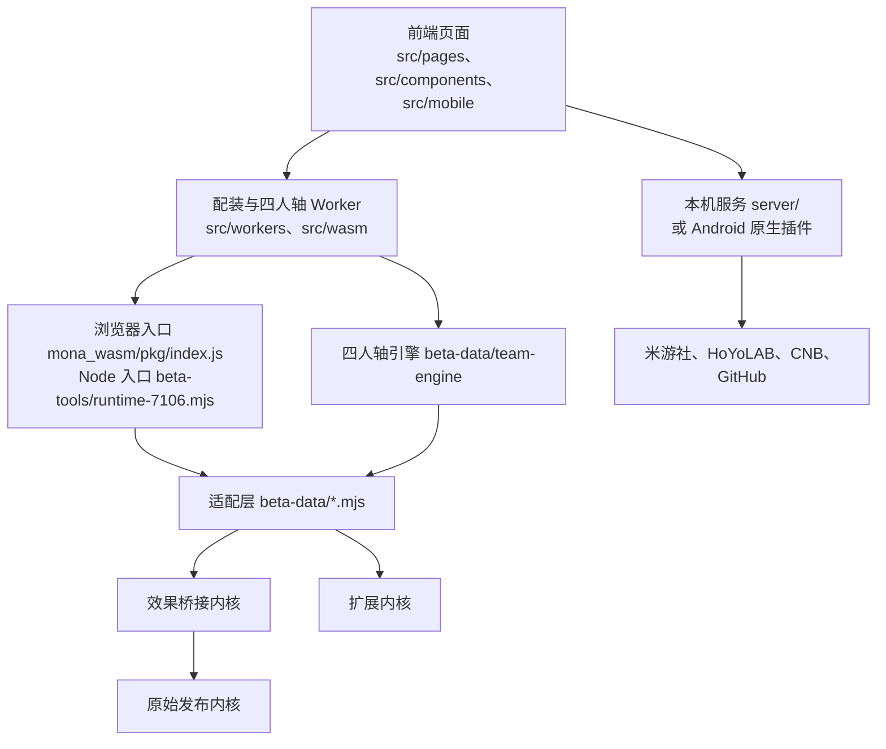

# 架构

项目由哪几块组成、一次计算怎么流过它们、每种发行形态装了什么。目录位置见根目录 `AGENTS.md` 的目录地图，术语见 `GLOSSARY.md`，各部分的技术选型见 `docs/dev/tech-stack.md`。

## 分层

| 层 | 职责 | 改动时注意 |
| --- | --- | --- |
| 前端页面 | 输入角色、装备、BUFF、敌人和目标，展示结果；数据存在浏览器存储 | 桌面 UI 与新移动 UI 共用页面逻辑，构建时把 `element-plus` 替换成 `src/mobile/index.js` |
| Worker | 把配装、词条收益、四人轴搜索放到后台线程，支持进度和取消 | Worker 通过 `import('mona')` 拿到与页面同一个入口 |
| 入口 | 加载三个内核，按固定顺序套上适配层的各个包装，导出九个接口对象 | 浏览器入口和 Node 入口是两份手写的包装链，顺序必须一致 |
| 适配层 | BUFF 规则、参数转换、作用域、新角色和新武器的效果 | 公共入口的五条路径要得到一致结果 |
| 四人轴引擎 | 把动作轴展开成命中事件，按角色包求值，再调适配层算伤害 | 角色包在 `character-packages.mjs` 注册，界面由注册表投影 |
| 内核 | 原始发布内核负责上游已有的角色和公式；效果桥接内核是它的改写版；扩展内核承载新角色 | 原始发布内核保持原样（ADR 0001） |
| 本机服务 | 托管 `dist/`，代理米游社与 HoYoLAB 登录和导入，检查并安装更新，用 DPAPI 保存凭据 | 只接受本机来源的请求；Android 上由 Capacitor 原生插件承担同样的职责 |

## 一次配装计算的路径

1. 页面收集角色、武器、圣遗物仓库、BUFF 和目标函数，交给 `src/wasm/single_optimize.js`。
2. Worker（`src/workers/optimize_artifact.js`）加载入口，调用 `OptimizeSingleWasm.optimize`。
3. 入口最外层的 `withInterfaceContracts` 处理参数别名、默认值、停用的 BUFF 和自定义敌人，再逐层向内传。
4. 各层包装按角色和装备判断由谁处理：上游已有的走效果桥接内核，新角色和新武器走扩展内核，星烁和月曜直伤等由适配层自己算。
5. 结果连同进度和阶段耗时回到页面。

单次伤害、面板、DSL 和词条收益走同一条包装链，只是调用的接口对象不同。

## 发行形态

| 形态 | 界面 | 本机能力由谁提供 | 存储位置由什么决定 | 构建入口 |
| --- | --- | --- | --- | --- |
| Windows 安装包、ZIP 便携包 | 用户的默认浏览器 | 托盘启动器拉起随包的 Node.js 运行本机服务，端口 4174 | 浏览器加 `http://127.0.0.1:4174` | `script/build-web-package.ps1`、`script/build-windows.ps1` |
| 开发时本机运行 | 浏览器 | `npm start`，端口 4183 | 浏览器加 `http://127.0.0.1:4183` | `npm run build:local` |
| Android（Element Plus） | Capacitor WebView | `MonaLocalPlugin` 等原生插件 | 应用 ID `com.mona.artifact.local` | `script/build-android.ps1 -Ui elementplus` |
| Android（新移动 UI） | Capacitor WebView | 同上 | 应用 ID 加 `.mobiletest` 后缀 | `script/build-android.ps1 -Ui mobiletest` |
| Windows Tauri 封装 | WebView2 窗口 | 内嵌的 Node.js 运行同一套本机服务，端口 47504 | 应用标识 `com.mona.artifact.tauri7204` 下的 WebView 目录 | 仓库里没有构建脚本，载荷由 `tauri-exe/prepare-payload.py` 生成 |

每种形态各有一份存储，互相不共享，换形态要靠「UID 数据」导出再导入。

## 已知的结构问题

这些是现状，不是规则。处理计划见 `docs/specs/repo-cleanup/`，桌面封装的决策见 `docs/adr/0002-tauri-shell-stays-experimental.md`。

- **两份包装链靠人工同步。** 浏览器入口和 Node 入口各写了一遍十几层的包装调用，测试走的是 Node 入口，两处不一致时测试发现不了。
- **`beta-data/` 和 `beta-tools/` 的名字已经不符合内容。** 前者是正式的适配层，根目录平铺了一百多个文件，规则、数据 JSON、校验清单和笔记混在一起；后者同时放着 Node 运行入口、冒烟脚本和一次性数据提取脚本。
- **版本号写进了文件名和标识。** 测试、脚本、适配层模块里有几十个带 `7106`、`7108`、`7201` 的文件名，其中一部分仍是当前入口（例如 `runtime-7106.mjs`、`preview-7201-facade.mjs`）。Tauri 封装的应用标识和包名也带着 `7204`，标识变了存储位置就跟着变。
- **Tauri 封装没有接进构建和发版流程。** 它依赖仓库外的 `../launcher/runtime` 和构建时才生成的 `runtime/hoyolab-login`，目前只是保留的源码。
- **上游遗留的配置仍在。** 备案、CDN、`www.mona-uranai.com` 代理这些开关服务于上游的线上站点，本项目只做本地发行。
