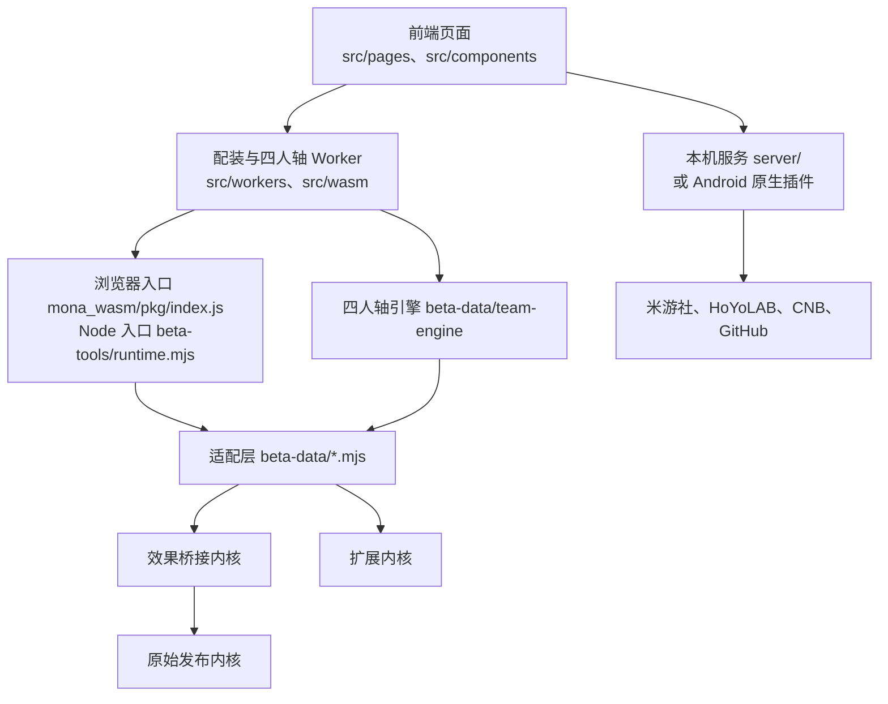

# 架构

计算调用链、模块职责或发行形态变化时更新。

项目由哪几块组成、一次计算怎么流过它们、每种发行形态装了什么。目录位置见根目录 `AGENTS.md` 的目录地图，术语见 `GLOSSARY.md`，各部分的技术选型见 `docs/dev/tech-stack.md`。

## 分层

| 层 | 职责 | 改动时注意 |
| --- | --- | --- |
| 前端页面 | 输入角色、装备、BUFF、敌人和目标，展示结果；数据存在浏览器存储 | 桌面和手机共用一套页面（Element Plus），按宽度自适应 |
| Worker | 把配装、词条收益、四人轴搜索放到后台线程，支持进度和取消 | Worker 通过 `import('mona')` 拿到与页面同一个入口 |
| 入口 | 加载三个内核和数据，交给 `beta-data/compose-kernel-api.mjs` 套上适配层的各个包装，导出九个接口对象 | 包装顺序只在组合模块里改；浏览器入口用 fetch 加载带进度的内核，Node 入口读文件 |
| 适配层 | BUFF 规则、参数转换、作用域、新角色和新武器的效果 | 公共入口的五条路径要得到一致结果 |
| 四人轴引擎 | 把动作轴展开成命中事件，按角色包求值，再调适配层算伤害 | 角色包在 `character-packages.mjs` 注册，界面由注册表投影 |
| 内核 | 原始发布内核负责上游已有的角色和公式；效果桥接内核是它的改写版；扩展内核承载新角色 | 原始发布内核保持原样（ADR 0001） |
| 本机服务 | 托管 `dist/`，代理米游社与 HoYoLAB 登录和导入，检查并安装更新，用 DPAPI 保存凭据 | 只接受本机来源的请求；Android 上由 Capacitor 原生插件承担同样的职责 |

## 一次配装计算的路径

1. 页面收集角色、武器、圣遗物仓库、BUFF 和目标函数，交给 `src/wasm/single_optimize.js`。
2. Worker（`src/workers/optimize_artifact.js`）加载入口，调用 `OptimizeSingleWasm.optimize`。
3. 入口最外层的 `withInterfaceContracts` 处理参数别名、默认值、停用的 BUFF 和自定义敌人，再逐层向内传。
4. 各层包装按角色和装备判断由谁处理：上游已有的走效果桥接内核，新角色和新武器走扩展内核，星烁和月曜直伤等由适配层自己算。
5. 结果连同进度和阶段耗时回到页面。

单次伤害、面板、DSL 和词条收益走同一条包装链，只是调用的接口对象不同。

## 发行形态

Windows 安装器和便携包由托盘启动器拉起 Node 服务，在默认浏览器中展示页面。Tauri 把网页和同一本机服务封装进独立的 WebView2 窗口。Android 则由 Capacitor 承载网页，通过原生插件提供本机能力。各形态的端口、存储隔离、迁移方法和构建入口见[服务与多端打包](services-and-platforms.md)。

## 已知的结构问题

这些是现状，不是规则。处理计划见 `docs/specs/repo-cleanup/`，桌面封装的决策见 `docs/adr/0002-tauri-shell-stays-experimental.md`。

- **`beta-data/` 和 `beta-tools/` 的名字已经不符合内容。** 前者是正式的适配层，根目录平铺了一百多个文件，规则、数据 JSON、校验清单和笔记混在一起；后者同时放着 Node 运行入口、冒烟脚本和一次性数据提取脚本。
- **版本号写进了文件名。** 测试、脚本、适配层模块里有几十个带 `7106`、`7108`、`7201` 的文件名，其中一部分仍在使用（例如 `preview-7201-facade.mjs`）。新文件不再带版本号，已有的不改名。
- **Tauri 封装有独立载荷生成步骤。** 生成载荷时需要 Node 运行时与预先构建的 HoYoLAB 登录窗口。定位和构建入口见[服务与多端打包](services-and-platforms.md)。
- **上游遗留的配置仍在。** 备案、CDN、`www.mona-uranai.com` 代理这些开关服务于上游的线上站点，本项目只做本地发行。
