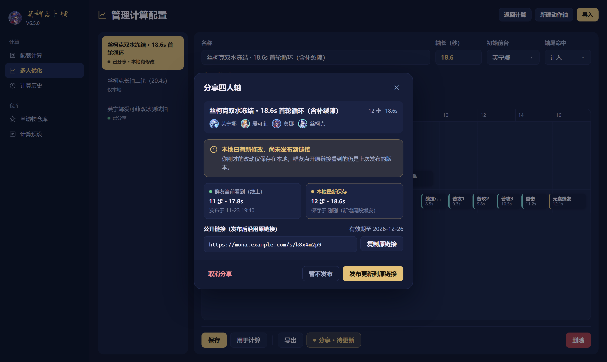
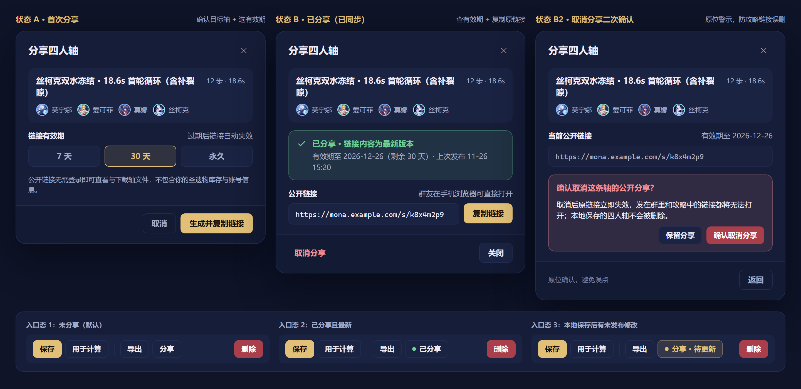
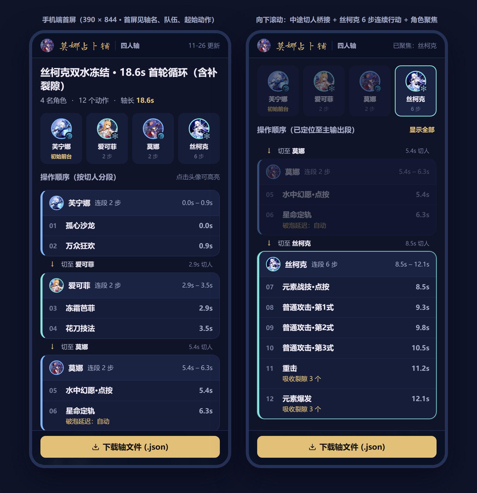
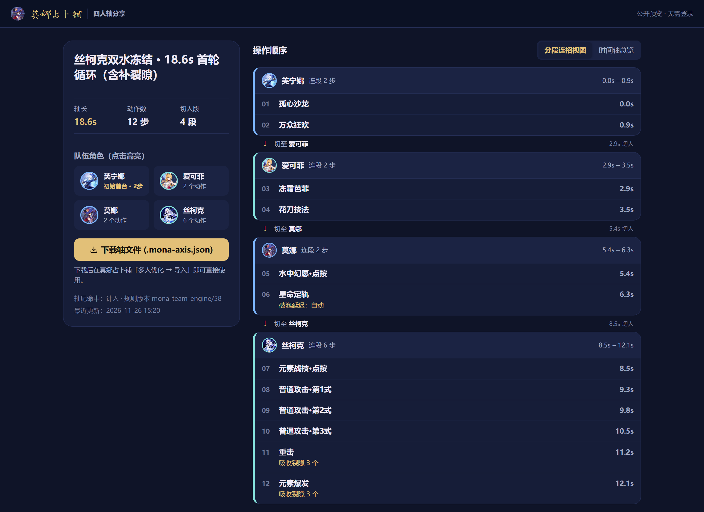
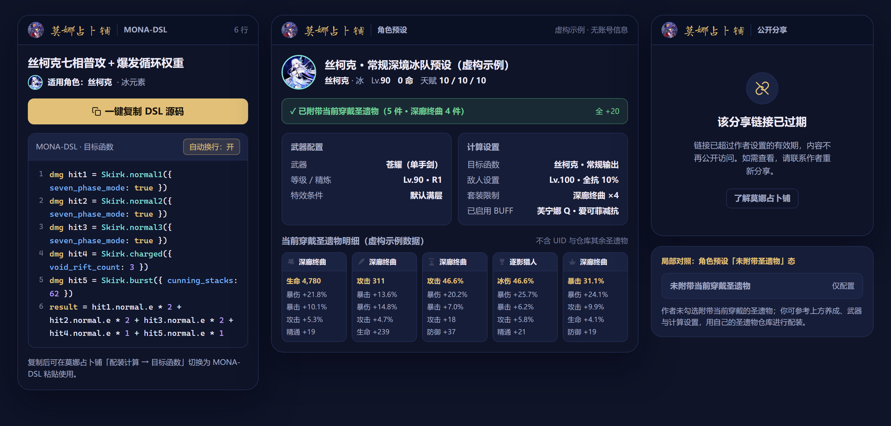

# 莫娜占卜铺 · 「分享链接」高保真设计稿与前端交互规范

Status: ready-for-human

> [!TIP]
> 配套可交互高保真原型：[share-link-prototype.html](./share-link-prototype.html)，可在浏览器中直接切换弹窗四态、手机/桌面预览、含/无时间源数据、长行换行、圣遗物附带开关以及深浅色主题。

## 一、设计总览与视觉沿用

1. **视觉体系**：完全沿用莫娜占卜铺现有「夜空配色」（[content-theme.css](../../../src/styles/content-theme.css) 与 [team-dps-night.css](../../../src/pages/TeamOptimizationPage/team-dps-night.css)），以深蓝夜空 `#0f1428` 为底、色阶卡片 `#161d38` / `#1b2343` 区分层级、星盘金 `#e2c078`（暗金字 `#17120a`）作为唯一主操作色；元素识别色沿用 [TeamDpsPage.vue](../../../src/pages/TeamOptimizationPage/TeamDpsPage.vue) 既有定义，店名使用随包字体 `Mona Brand`（龙藏体）。
2. **两套宿主边界**：
   - **发布侧（莫娜内）**：放在现有「多人优化 → 管理计算配置」编辑区（[TeamOptimizationWrapper.vue](../../../src/pages/TeamOptimizationPage/TeamOptimizationWrapper.vue)）底部操作条与 `el-dialog.cx-scope` 弹窗内，沿用项目既有的 Element Plus 主题变量，自动兼容深浅色模式。
   - **接收侧（独立公开网页）**：免登录、免装客户端、默认夜空深色（手机群聊点开护眼且与主站风格统一），顶部仅保留极简品牌栏（莫娜头像 + 店名 + 内容类型），首屏直入正文。
3. **版本范围控制**：首版聚焦四人轴（仅四人轴支持「原链接发布更新」）；提供四人轴 `.mona-axis.json` 下载与 DSL 源码一键复制；不设一键唤起客户端、分享广场、评论、点赞、浏览统计或个人主页。

---

## 二、界面 1：发布者在莫娜里的分享入口与弹窗

### 旗舰图 1 · 桌面端「本地有修改」的分享弹窗（含编辑页入口位置关系）



### 局部状态图 · 首次分享 / 已分享 / 取消分享二次确认 / 入口按钮三态



### 2.1 四人轴编辑页入口位置关系

在现有 `TeamOptimizationWrapper.vue` 的 `.editor-actions`（原顺序：`保存`、`用于计算`、`导出`、`删除`）中做最小结构调整：

```text
[ 保存 (primary) ]  [ 用于计算 ]  |  [ 导出 ]  [ 分享 / ● 已分享 / ● 分享·待更新 ]    <弹性间距>    [ 删除 (danger) ]
 └─────── 本地编辑与计算组 ───────┘    └───────────── 对外输出组 ─────────────┘                      └── 危险操作隔离 ──┘
```

- **位置理由**：「分享」与「导出」同属「对外输出」，用 `1px` 细竖线（`height: 22px`, `var(--cx-step-2)`）与左侧「保存 / 用于计算」轻微区隔；用 `margin-left: auto` 将红色「删除」推至最右端，避免作者点分享时误触删除。
- **入口状态回显（打通「保存到本地」与「发布更新」心智）**：
  - **未分享**：普通次按钮 `分享`。
  - **已分享且已同步**：普通次按钮 `● 已分享`（绿点 `--cx-down`）。
  - **本地保存后有未发布修改**：浅金底描边按钮 `● 分享 · 待更新`（金点 `--cx-gold`，`--cx-gold-soft` 底色）；同时左侧轴列表当前选中项下方增加小字 `● 已分享 · 本地有修改`。
  - **本地保存 Toast 配合**：当轴已处于「已分享」态，作者点击编辑页底部「保存」时，成功提示使用候选文案提醒（仅保存本地、未同步线上），不再让作者误以为保存即群里已更新。

### 2.2 弹窗状态与按钮点击结果标注

| 弹窗状态 | 核心布局与视觉层级 | 按钮 / 交互 | 点击结果与反馈 |
| --- | --- | --- | --- |
| **顶部共用对象卡** | 轴标题（最多 2 行截断，hover 显示完整 title）+ 动作数/轴长 + 4 人圆形小头像与名字 | 只读展示 | 防止作者在左侧切错轴后把错误链接发进群 |
| **A. 首次分享** | 对象卡 → 有效期分段单选（`7 天` / `30 天` 默认 / `永久`）→ 隐私说明（候选文案） | `取消` | 关闭弹窗，不创建链接 |
| | | **`生成并复制链接`**（唯一金色主按钮） | 按钮进 `loading` → 调用创建分享接口 → 自动写入剪贴板 → 原位切换至「已分享」态并弹出 `ElMessage.success`；若剪贴板写入被浏览器拒绝，仍切入「已分享」态并提示手动点「复制链接」 |
| **B. 已分享（已同步）** | 对象卡 → 浅绿同步状态条（含到期日期与上次发布时间）→ 只读链接框 + 并排主按钮 | **`复制链接`**（金色主按钮） | 复制链接至剪贴板，按钮文案短暂切换 `已复制`（1.8s）+ `ElMessage.success` |
| | | `取消分享`（左下角文字型 danger，低权重） | 不弹第二层遮罩，在弹窗内**原位展开红色确认区块**（切至状态 B2） |
| | | `关闭` | 关闭弹窗 |
| **B2. 取消分享二次确认** | 链接框降透明 → 原位红色警示框说明「原链接立即失效、本地轴不删除」 | `保留分享` / `返回` | 收起确认区块，回到上一状态（已分享或本地有修改） |
| | | **`确认取消分享`**（实心 danger） | 按钮进 `loading` → 调用失效接口 → 清除本地该轴分享元信息 → 回到「首次分享」态并提示 `已取消分享` |
| **C. 本地有修改（重点）** | 对象卡 → **琥珀金警示条** → **双栏版本对照卡**（左：`● 群友当前看到（线上）` 步数/轴长/发布时间；右：金框 `● 本地最新保存` 步数/轴长/保存时间）→ 链接行（标注「发布后沿用原链接」） | `复制原链接`（**降级为普通次按钮**，不抢主按钮） | 复制原链接，Toast 提示复制的是线上旧版（提醒尚未包含本次修改） |
| | | `暂不发布` | 关闭弹窗，保留本地修改，底部入口继续维持 `● 分享 · 待更新` |
| | | **`发布更新到原链接`**（**唯一金色主按钮**） | 若编辑器内有尚未落盘的草稿，先执行本地保存再推送更新 → 覆盖原链接指向的新快照（**URL 不变**）→ 弹窗切回「已分享（已同步）」态并 Toast 提示群里原链接已同步为新版 |
| | | `取消分享`（左下角文字型 danger） | 切至原位二次确认（状态 B2） |

### 2.3 弹窗与编辑页的窄屏及异常边界

- **窄屏适配（`≤ 800px`）**：
  - 弹窗宽度 `width="min(520px, 94vw)"`，加 `.viewport-dialog` 类（`max-height: 82vh`，body 内滚动，header/footer 固定）。
  - 双栏版本对照卡（`.version-compare`）在 `≤ 440px` 时改为单列上下堆叠；链接输入框与复制按钮保持同行（输入框 `min-width: 0; text-overflow: ellipsis`），极窄屏（`≤ 360px`）下折行全宽。
  - 编辑页 `.editor-actions` 在 `≤ 800px` 时自动换行，取消 `margin-left: auto` 对「删除」的强推，避免单行只剩一个删除按钮孤悬右侧。
- **未保存草稿直接点「分享」**：若作者改了时间轴但还没点「保存」就点「分享」，首次分享或发布更新前自动校验并保存草稿；若当前轴校验不通过（如 0 个动作、轴长为 0s），禁止生成/发布，在弹窗顶部内联 `el-alert[type="error"]` 展示具体校验错误原因（遵循项目「真实错误照实暴露」约定）。

---

## 三、界面 2：群友点开链接后的四人轴公开预览页

### 旗舰图 2 · 手机端公开预览（390 × 844 首屏 + 向下滚动长连段体验）



### 旗舰图 3 · 桌面端同一条四人轴公开预览（1320 宽双栏布局）



### 3.1 长轴阅读体验的核心设计：切人分段 · 连段归组卡片

示例数据取自仓库现有 `beta-data/team-engine/characters/` 的 4 位已实装角色（**芙宁娜、爱可菲、莫娜、丝柯克**）共 **12 个真实动作**（含参数 `破泡延迟：自动` 与 `吸收裂隙 3 个`）：

1. **首屏信息密度（手机 390×844）**：
   - 顶部极简品牌栏 `48px`（莫娜头像 + 莫娜占卜铺 + `四人轴` + 更新日期），不放宣传横幅或登录入口。
   - 首屏完整露出三件事：**① 轴标题与摘要（4 名角色 · 12 个动作 · 轴长 18.6s）**、**② 4 等分队伍角色栏（含元素小标与「初始前台」标记）**、**③ 操作顺序前 2～3 段动作**，群友点开 1 秒内就能看懂队伍和起手。
2. **同一角色连续行动 vs 中途切人的视觉区分**：
   - **归组规则**：将相邻且 `actor` 相同的动作自动合并为一张「行动段卡（Turn Card）」，共享左侧 `4px` 元素色竖条与顶部段头（头像 + 角色名 + `连段 N 步` + 可选时间跨度 `8.5s – 12.1s`）。
   - **同角色连续行动（如丝柯克 6 步）**：段内采用紧凑行列表（步序 `07`～`12` + 技能名 + 金色参数小行 + 右侧时间），**不再每行重复角色头像与名字**，读者可以像读连招表一样一口气打包记忆。
   - **中途切人**：段与段之间插入独立「切人连接桥」（`↓ 切至 丝柯克` + 可选切人时刻 `8.5s 切人`），段内紧凑、段间呼吸，扫一眼就能数清整条轴切了几次人。
   - **点击头像高亮聚焦**：点击队伍栏中任意角色，该角色的所有行动段边框亮起元素色，其余角色行动段降为 `opacity: 0.36`（不隐藏，保留上下文顺序）；再次点击或点「显示全部」恢复。
3. **时间信息按源数据条件显示**：
   - 仅当源数据提供有效时间字段（`timeMs` / `durationMs`）时，才显示右侧单步时刻、段头时间区间、切人时刻与顶部总轴长；若源数据无时间信息，自动隐藏所有时间列与桌面端「时间轴总览」切换项，绝不渲染 `0.0s` 或 `--s` 占位符。

### 3.2 按钮点击结果、响应式变化与极端数据规则

| 维度 | 交互 / 布局规则 |
| --- | --- |
| **下载轴文件按钮** | 手机端固定在底部吸底条（含 `env(safe-area-inset-bottom)`）；桌面端位于左侧粘性摘要卡内。点击直接触发下载 `<sanitized-title-or-id>.mona-axis.json`（无需登录），弹出轻量 Toast `已开始下载…`；文件格式与现有 `exportTeamDpsConfiguration` 一致，下载后可在客户端「多人优化 → 导入」直接读取。 |
| **桌面端视图切换** | 桌面端（`≥ 960px`）右栏顶部提供分段切换：**「分段连招视图（默认）」** 与 **「时间轴总览（4 轨只读甘特图）」**；手机端与无时间源数据时不显示「时间轴总览」，避免 4 轨横向挤压。 |
| **窄屏布局断点** | `≥ 960px`：双栏 `332px (sticky) + minmax(0, 1fr)`，最大容器宽 `1140px`；`< 960px`：单栏纵向流，队伍切换为 4 等分网格，下载按钮移至底部吸底条，正文底部预留 `86px` 防遮挡。 |
| **超长标题处理** | 公开预览页标题**不截断**（完整折行显示，`word-break: break-word`），避免攻略作者写的命座/循环备注被吞掉；分享弹窗的对象卡内限制最多 2 行省略 + 原生 `title` 悬浮完整查看。 |
| **超长动作列表（30～80 步）** | 按切人归组后卡片数量通常仅 8～20 张，天然比逐行平铺节省约 35% 垂直高度；滚动期间手机端顶部可保持精简品牌栏吸顶，超过 24 步时可在右下角（吸底条上方 `16px`）出现轻量「回到顶部」圆钮；点击队伍角色头像高亮筛选仍保留全轴结构，便于快速定位同一角色多轮出场。 |

---

## 四、另外两类内容与链接失效态（沿用同一公开页面框架）



### 4.1 MONA-DSL 目标函数公开预览

- **信息结构**：同一顶栏（类型标 `MONA-DSL` + 总行数）→ 标题 + **适用角色行**（角色头像 + 名称 + 元素）→ 全宽金色主按钮 **`一键复制 DSL 源码`** → 等宽代码阅读器 → 简短使用提示（候选文案）。
- **手机端长行代码处理**：
  - 代码器左列为固定 `34px` 行号（`user-select: none`，用户手动选区复制时不会混入行号），右侧为带轻量夜空语法着色的源码。
  - 提供右上角 **`自动换行：开 / 关`** 切换按钮：**手机端默认开启自动换行**（如 `result = hit1... + hit5...` 软折行展示，无需手指左右来回拖），**桌面端默认关闭换行允许横向滚动**以保持长公式整齐对齐。
- **点击结果**：点击「一键复制 DSL 源码」写入剪贴板，按钮文字变为 `✓ 已复制 DSL 源码`（1.8s）+ Toast；若微信/QQ 内置 WebView 禁用 `navigator.clipboard`，降级执行 `textarea + execCommand('copy')`，仍失败时提示长按代码区全选复制。

### 4.2 角色预设公开预览（虚构数据，零 UID / 账号信息）

- **信息结构**：同一顶栏（类型标 `角色预设`）→ 角色身份头（头像、预设名、角色名、等级、命座、天赋）→ **圣遗物附带状态显性横条** → 双卡并列（`武器配置` + `计算设置`，含目标函数、敌人等级/抗性、套装/词条限制、已启用 BUFF）→ 圣遗物明细区（按附带状态条件渲染）。
- **让读者一眼分清「是否附带当前穿戴圣遗物」**：
  - **已附带**：浅绿横条 `✓ 已附带当前穿戴圣遗物（5 件 · 深廊终曲 4 件）`，下方展示 5 部位圣遗物精简卡（部位图标 + 套装名 + 金色主词条 + 4 条副词条；桌面端 5 列，手机端 2 列或单列紧凑卡）。
  - **未附带**：中性灰横条 `未附带当前穿戴圣遗物 · 仅配置`，隐藏 5 件套网格并用一行清晰说明告知读者按上方配置在自己仓库中配装（见图 5 右下对照卡）。
- **隐私边界**：公开页数据模型严格剥离 `miyousheKey`、UID、账号名、仓库中其余未穿戴圣遗物 ID。

### 4.3 链接已过期 / 已取消简洁态

- 沿用同一顶部品牌栏，正文居中单卡（`max-width: 440px`），呈现暗金断链图标 + 明确标题（`该分享链接已过期` / `该分享已取消`；若后端出于安全策略不区分原因则统一显示 `分享链接已失效`）+ 一句简短说明（候选文案）+ 弱化次按钮 `了解莫娜占卜铺`（跳转产品首页/说明页，不做弹窗劝装）。

---

## 五、新增提示语「候选文案」确认清单

以下为本次设计中新增的界面提示语，均标为**候选文案**，待产品方确认或微调后落入代码：

| 位置 | 候选文案 | 用途说明 |
| --- | --- | --- |
| 编辑页「保存」Toast（仅已分享轴触发） | `已保存到本地；如需同步给群友，请在分享中发布更新` | 防止作者误以为点「保存」就会更新群里的链接 |
| 分享弹窗 · 首次分享底部说明 | `公开链接无需登录即可查看与下载轴文件，不包含你的圣遗物库存与账号信息。` | 消除作者分享时的隐私顾虑 |
| 分享弹窗 · 本地有修改警示副文案 | `你刚才的改动仅保存在本地；群友点开原链接看到的仍是上次发布的版本。` | 清晰解释本地版本与线上版本分离 |
| 分享弹窗 · 本地有修改点「复制原链接」Toast | `已复制原链接（尚未包含本次本地修改）` | 防止作者误将旧版链接当作新版发出 |
| 分享弹窗 · 取消分享二次确认正文 | `取消后原链接立即失效，发在群里和攻略中的链接都将无法打开；本地保存的四人轴不会被删除。` | 避免误操作同时安抚不会删本地存档 |
| 四人轴公开页 · 下载按钮下方说明 | `下载后在莫娜占卜铺「多人优化 → 导入」即可直接使用。` | 引导群友知道下载的 `.json` 去哪里导入 |
| MONA-DSL 公开页 · 代码块下方说明 | `复制后可在莫娜占卜铺「配装计算 → 目标函数」切换为 MONA-DSL 粘贴使用。` | 引导群友使用复制的 DSL 源码 |
| 角色预设公开页 · 未附带圣遗物提示 | `作者未勾选附带当前穿戴的圣遗物；你可参考上方养成、武器与计算设置，用自己的圣遗物仓库进行配装。` | 解释为何下方没有圣遗物明细 |
| 失效态 · 已过期 | `链接已超过作者设置的有效期，内容不再公开访问。如需查看，请联系作者重新分享。` | 告知过期原因与下一步 |
| 失效态 · 已取消 | `作者已取消这条内容的公开分享。如需查看最新版本，请联系作者重新获取链接。` | 告知取消原因与下一步 |

---

## 六、前端实现规范（Vue 3 + Element Plus）

### 6.1 颜色 Token（直接复用 `content-theme.css`）

| 语义角色 | CSS 变量 | 夜空深色（默认） | 浅色模式 | 使用位置 |
| --- | --- | --- | --- | --- |
| 页面底色 | `--cx-ground` | `#0f1428` | `#eef0f6` | 公开页 `body`、编辑页外框 |
| 主卡片面 | `--cx-card` | `#161d38` | `#ffffff` | 弹窗底、行动段卡、左摘要卡 |
| 抬升台阶 1 | `--cx-step` | `#1b2343` | `#f3f5fa` | 行动段头、对象卡、输入框、代码工具栏 |
| 分割线 / 边 | `--cx-step-2` | `#232c52` | `#e2e6f0` | 细线边框、按钮描边、分割竖线 |
| 主文字 | `--cx-letter` | `#eeeaf6` | `#121733` | 标题、技能名、关键数值 |
| 次文字 | `--cx-dim` | `#a3abc6` | `#5a6380` | 时间、说明、元信息、表单标签 |
| 弱文字 | `--cx-quiet` | `#747e9e` | `#7d86a3` | 步序编号、行号、次要脚注 |
| 主强调（星盘金） | `--cx-gold` / `--cx-gold-on` | `#e2c078` / `#17120a` | `#8a6420` / `#ffffff` | 唯一主按钮、轴长数字、待更新态、参数标签 |
| 待更新软底/边 | `--cx-gold-soft` / `--cx-gold-edge` | `rgba(226,192,120,.13)` / `.36` | `rgba(138,100,32,.10)` / `.32` | 「本地有修改」警示条、`分享·待更新`按钮 |
| 已同步成功 | `--cx-down` / `--cx-down-bg` | `#6fcf97` / `rgba(111,207,151,.12)` | `#2f8a5b` / `rgba(47,138,91,.09)` | 「已分享」状态条、已附带圣遗物条 |
| 危险 / 取消分享 | `--cx-up` / `--cx-up-btn` | `#ef8f95` / `#a93f4b` | `#c0474f` / `#c0474f` | 取消分享文字按钮、二次确认实心按钮 |
| 顶栏底色 | `--sh-night` | `#0b1124` | `#f4f2fa` | 公开页顶栏、手机底部吸底条 |
| 代码块底色 | `--code-bg`（新增） | `#10162c` | `#f6f8fc` | MONA-DSL 源码阅读区 |
| 元素色 | 沿用 `TeamDpsPage.vue` | 水 `#7eb8ff` / 冰 `#87e4df` / 火 `#ff9a81` / 雷 `#c0a2ff` / 风 `#77d8bd` / 岩 `#e8c77d` / 草 `#b3d975` | 浅色模式建议调深约 20% 保证 AA 对比 | 头像边框、行动段左 `4px` 指示条 |

### 6.2 关键尺寸、间距与字号

| 项 | 桌面端规范 | 手机端规范（`≤ 959px` / `390px` 基准） |
| --- | --- | --- |
| 公开页顶栏高度 | `52px`，左右内边距 `20px` | `48px`，左右内边距 `16px` |
| 公开页最大宽度 | `1140px` 居中，双栏 `332px + 1fr`，列间距 `24px` | `100%`，单栏内边距 `14px 16px 86px` |
| 分享弹窗尺寸 | `width="min(520px, 94vw)"`，圆角 `18px`（`--cx-radius`），内边距 `18px 22px` | `94vw`，最大高 `82vh`，body 内滚动 |
| 卡片圆角 | 大卡片 `18px` / 行动段卡 `14px` / 内嵌框 `12px` / 按钮与输入框 `8px` | 同左，移动端主操作按钮圆角 `10px` |
| 字号阶梯（严格 3 档正文 + 标题） | 品牌店名 `20px`（`Mona Brand`）；页面 `h1` `21px/1.35` Bold；区块标题 `16px` Semibold；正文/技能名 `14px/1.5`；辅助元信息 `12px–13px` | 页面 `h1` `19px/1.35` Bold；区块标题 `14px` Semibold；正文/技能名 `14px`；辅助信息 `12px`（首屏核心文字不小于 `12px`） |
| 数值排版 | 所有秒数、步数、日期、词条数值均启用 `font-variant-numeric: tabular-nums` | 同左 |
| 交互触控高度 | 普通 `el-button` `36px`，主下载按钮 `42px` | 底部吸底主按钮 `44px`，角色头像筛选格最小 `64px × 78px` |

### 6.3 推荐可复用组件拆分（Vue 3 + Element Plus）

1. **`ShareAxisDialog.vue`**（发布侧弹窗，挂在 `TeamOptimizationWrapper.vue` 中）
   - 基于 `el-dialog`（`custom-class="team-dps-dialog cx-scope viewport-dialog"`）、`el-button`、`el-radio-group`（或自定义分段组）、`el-alert`、`ElMessage`。
   - Props：`modelValue: boolean`、`axis: ActionAxis`、`shareRecord: ShareRecord | null`、`hasLocalChanges: boolean`、`hasUnsavedDraft: boolean`。
   - Emits：`update:modelValue`、`create(expiry)`、`publish-update()`、`revoke()`。
2. **`PublicShareShell.vue`**（公开预览页统一外框）
   - 负责顶栏品牌条、内容类型标识、居中容器与过期/取消状态回退渲染，供四人轴、MONA-DSL、角色预设三类页面复用。
3. **`AxisTurnSequence.vue`**（核心阅读组件，手机与桌面共用）
   - 纯展示分组函数 `groupAxisTurns(timeline, members)`：将连续同 `actor` 动作归组，并将显式 `switch` 或 `actor` 切换点提取为 `switchBridge`。
   - Props：`members`、`timeline`、`highlightSlot: string | null`、`showTime: boolean`（由是否含有效 `timeMs` 自动推导）。
   - 桌面端「时间轴总览」态可直接复用或提炼现有 `TeamActionTimeline.vue` 的只读渲染子集。
4. **`DslCodeViewer.vue`**（MONA-DSL 代码阅读器）
   - Props：`source: string`、`defaultWrap?: boolean`（手机默认 `true`，桌面默认 `false`）。
   - 内置行号分离排版、轻量正则词法高亮、换行切换与剪贴板降级复制。
5. **`PresetShareCard.vue`**（角色预设公开视图）
   - 复用莫娜现有武器/圣遗物名称映射（`@/assets/weapon`、`@/assets/artifacts`、`zh-cn.json`）与部位图标，按 `artifacts?.length > 0` 清晰切换「已附带 / 未附带」两种表现。

---

## 七、设计依赖但尚未确认的产品与后端能力清单

以下能力在设计稿中已体现或预留位置，开发前需与产品 / 后端（`online-service/`）逐项确认：

1. **登录与鉴权前提**：发布者创建、更新、取消分享链接，是否要求先登录「莫娜在线账号」（`online-service`），还是支持基于本地生成管理令牌（匿名发布 + 本地凭证管理）？若要求登录，未登录时点击「分享」需先引导登录或展示轻量提示。
2. **有效期档位与续期策略**：设计稿默认给出 `7 天 / 30 天 / 永久` 三档；需确认后端实际支持的档位、默认档位，以及**「发布更新到原链接」时是否自动顺延有效期**（还是维持原到期时间不变）。
3. **「本地有修改」的判定与线上摘要**：版本对照卡展示的「群友当前看到（线上）：11 步 · 17.8s · 发布于 11-23 19:40」，需确认是在本地存储发布时的轴内容哈希 + 概要快照（`publishedHash`、`publishedSummary`、`publishedAt`），还是每次打开弹窗向后端拉取远端元数据。本地保存快照最轻且离线可判定，但多设备登录时需以后端元信息为准。
4. **失效态是否区分「已过期」与「已取消」**：后端接口对失效链接是分别返回明确状态码/错误码（如 `EXPIRED` vs `REVOKED`），还是统一返回 `404`？若统一返回 `404`，失效页采用合并文案 `该分享链接已失效`。
5. **公开页静态资源与角色头像来源**：公开网页部署在独立域名/路径时，角色头像需确认使用公开可访问的本地打包静态资源（或与 `online-service/static/avatars.js` 同源策略），避免外链防盗链导致手机浏览器头像裂图；加载失败时应有元素色底 + 角色首字兜底。
6. **四人轴「删除」与已分享链接的关系**：当作者在本地编辑页点击红色「删除」删除一条**已分享**的四人轴时，需确认产品规则：是同步取消线上分享链接，还是仅删本地（保留线上链接直至到期）？建议删除确认弹窗里明确告知这一结果。
7. **MONA-DSL 与角色预设的分享入口及首版上线节奏**：设计稿已给出二者的公开预览框架；首版是否同步在「配装计算 → DSL」与「计算预设卡片菜单」开放分享入口，以及角色预设分享弹窗中「附带当前穿戴圣遗物」勾选框默认勾选还是默认不勾选（建议默认不勾选，由作者主动勾选以保护个人圣遗物信息），需产品确认。
