# 莫娜占卜铺 7.1.11 使用文档

适用版本：7.1.11 当前源码。更新日期：2026 年 10 月 15 日。

莫娜占卜铺用于管理圣遗物、查看角色在指定条件下的伤害，并从现有仓库中搜索符合要求的单人配装。本指南重点介绍“计算器”，帮助你完成从导入装备、设置战斗条件，到比较配装和判断词条收益的完整流程。

7.1.11 尚未构建正式网页包、Windows 安装包或 Android APK；使用旧版成品时，部分界面可能与本文不同。多人优化由独立的 7.1.10Beta 副本继续开发，不在本指南的操作范围内。

本文截图来自 7.1.11 源码在 Windows 本机实际运行的浏览器界面，使用独立的合成演示装备；配装与伤害数字用于说明操作。截图保留实际界面，未拼接按钮或改写数值。下文以桌面三栏布局指路，手机入口需按对应分区查找。

阅读或分享本文时，请同时保留 `images/user-guide-7.1.11/` 图片目录，保持与本 Markdown 文件的相对位置。

## 目录

- [1 功能入口与基本概念](#1-功能入口与基本概念)
- [2 准备角色与圣遗物数据](#2-准备角色与圣遗物数据)
- [3 计算器快速上手](#3-计算器快速上手)
- [4 设置角色武器与敌人](#4-设置角色武器与敌人)
- [5 设置 BUFF 与队友来源](#5-设置-buff-与队友来源)
- [6 当前圣遗物与装备对比](#6-当前圣遗物与装备对比)
- [7 自动配装的目标与搜索设置](#7-自动配装的目标与搜索设置)
- [8 阅读伤害与搜索结果](#8-阅读伤害与搜索结果)
- [9 面板与词条收益曲线](#9-面板与词条收益曲线)
- [10 保存预设套装与跨设备数据](#10-保存预设套装与跨设备数据)
- [11 使用 MONA-DSL 自定义目标](#11-使用-mona-dsl-自定义目标)
- [12 常见问题与 Debug](#12-常见问题与-debug)
- [附录 源码索引](#附录-源码索引)

## 1 功能入口与基本概念

### 1.1 常用入口

| 入口 | 用途 |
| --- | --- |
| 账号 | 创建、切换和管理莫娜本地账号，分别保存不同的数据集 |
| UID 数据 / 手机互传 | 米游社账号管理、同步角色、导入或导出 UID 数据包及角色快照 |
| 圣遗物 | 导入、添加、编辑、筛选和导出仓库圣遗物，查看评分与锁定状态 |
| 圣遗物套装 | 将指定的五个部位保存为圣遗物组，并用收藏夹整理 |
| 计算预设 | 管理、导入和导出已保存的角色计算配置 |
| 计算器 | 查看单次伤害、搜索单人配装、比较装备和分析词条收益 |
| 设置 | 切换语言及管理本地存储 |
| Playground | 使用代码进行进阶计算；日常配装可直接使用计算器 |

“莫娜账号”“米游社账号”和“原神 UID”各有用途：莫娜账号是软件内的数据分组；米游社账号用于登录和读取绑定角色；UID 对应具体的游戏角色数据。切换莫娜账号后，先确认仓库和预设是否属于本次要计算的数据集。

### 1.2 四个容易混淆的概念

| 名称 | 含义 |
| --- | --- |
| 当前配装 | 计算器中当前放置的五个部位，决定眼前的面板和伤害 |
| 目标函数 | 自动搜索时用来比较配装优劣的评价规则，可以是一段伤害、多个技能的组合或某项属性 |
| 计算预设 | 保存角色、武器、BUFF、目标函数、搜索设置等配置，便于以后重复使用 |
| 圣遗物组 | 保存具体的装备组合，界面中的“存为套装”“应用套装”操作的是这类数据 |

“限定套装”指某个游戏套装的四件套或两个套装的 2＋2；“圣遗物组”则是你收藏的一组具体装备。两者不是同一个筛选条件。

## 2 准备角色与圣遗物数据

### 2.1 从米游社导入角色

可以从“UID 数据 / 手机互传”进入，也可以在计算器的角色区域点击“米游社导入”。

1. 点击“米游社扫码登录”，扫码后在手机上确认登录。已保存账号可直接点击“使用”；需要更换登录信息时，使用“扫码添加 / 更新账号”。
2. 在原神账号列表中选择要同步的 UID。
3. 点击“同步全部角色”，等待同步结束，查看角色数、圣遗物新增与复用数量，以及具体错误或提示。
4. 在“已保存的角色”中选择角色；计算器内也可以通过“我的角色”按 UID 和元素筛选后加载。
5. 检查角色等级、命座、天赋、武器及当前装备，再设置本次战斗条件。

当前这条同步路径面向国服米游社。HoYoLAB 海外同步尚未实现。同步取得的是角色及其已穿戴装备，未穿戴的仓库圣遗物需要另行导入；只同步角色后，自动配装可用的候选数量可能很少。

桌面扫码登录依赖随应用启动的本机服务。遇到“本机服务连接失败”时，先确认通过对应版本的启动器打开应用。自行运行源码时，本机服务入口为 `npm start`；当前源码默认地址为 `http://127.0.0.1:4183`，以启动日志实际显示的地址为准。

### 2.2 从文件导入圣遗物

**入口：左侧导航「圣遗物」→「导入」→选择 JSON 文件。**

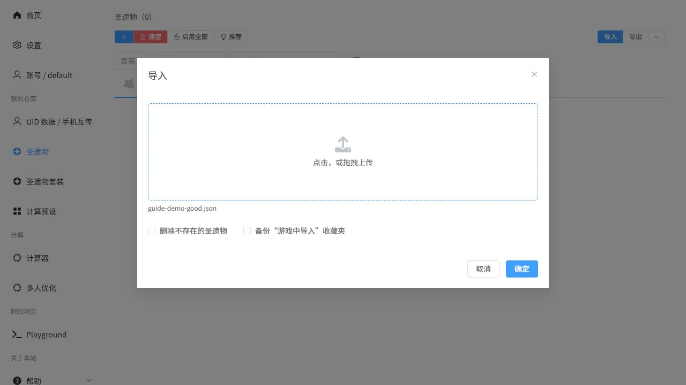

**图 1 · 仓库导入窗口**

图中已选中演示 GOOD 文件。先核对两个勾选项，再点右下角「确定」；只导入部分装备时，保持「删除不存在的圣遗物」关闭。

1. 打开“圣遗物”，点击“导入”；手机窄屏界面在“导入 / 导出”菜单中操作。
2. 点击上传区域选择 JSON 文件，桌面也可以拖入文件。
3. 根据这次导入的范围，设置“删除不存在的圣遗物”和“备份‘游戏中导入’收藏夹”。
4. 点击“确定”，导入后按五个部位检查数量、等级和词条。

支持莫娜圣遗物 JSON，以及 GOOD v1、v2、v3 圣遗物数据，包括 GOODScanner 和 YAS 生成的对应 GOOD 文件。GOOD 文件中的角色、武器等其他类别不会通过这个入口自动变成完整的计算预设。

| 导入选项 | 实际作用 | 使用场景 |
| --- | --- | --- |
| 删除不存在的圣遗物 | 删除当前仓库中、此次文件没有包含的旧圣遗物 | 文件确实代表完整最新仓库时使用；导入部分装备时不要勾选 |
| 备份“游戏中导入”收藏夹 | 更新导入装备组之前，备份原有的该收藏夹 | 希望保留上次穿戴组合时使用 |

带装备归属的数据会用于生成“游戏中导入”收藏夹内的圣遗物组。GOOD 的游戏内锁定标记不会自动转成莫娜的“排除计算”锁定；软件中已有的锁定状态会保留。

也可以用“圣遗物”页的新增入口手动录入。录入后先检查部位、套装、星级、强化等级、主词条和副词条，尤其注意固定数值与百分比属性的区别。

### 2.3 自动配装实际会使用哪些装备

**当前自动配装只使用强化等级达到 +16 的候选圣遗物。** 仓库中存在一件装备，并不代表它一定会进入搜索。软件锁定、主词条筛选、已穿戴保护、圣遗物组过滤和关联队友占用，都会继续缩小候选范围，详见第 7 节。

手动放入计算器的装备仍可用于当前面板和伤害计算；不要把自动搜索的候选门槛理解成手动查看伤害的门槛。

## 3 计算器快速上手

### 3.1 先认识页面

**入口：左侧导航「计算器」。**

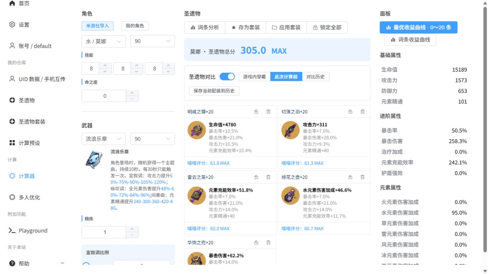

**图 2 · 计算器总览：左边设置角色，中间管理装备，右边查看面板**

图中左栏可直接选择角色与武器，中栏顶部是「词条分析」「存为套装」「应用套装」「锁定全部」，右栏顶部是两种收益曲线。

桌面宽屏界面主要分为三栏：

| 区域 | 主要内容 |
| --- | --- |
| 左栏 | 角色、武器、目标函数、开始计算、计算设置、圣遗物设置、预设、BUFF |
| 中栏 | 当前五件装备、喵喵评分、装备对比、单次技能伤害、敌人设置 |
| 右栏 | 当前面板、词条收益曲线、最优收益曲线 |

窄屏计算器可通过“角色与配置”“圣遗物与伤害”“面板与曲线”切换分区。手机重构界面仍处于源码试验阶段，已安装的历史 APK 可能使用旧布局。

#### 常用操作入口速查

| 想做什么 | 从哪里点 | 找不到时 |
| --- | --- | --- |
| 选角色、改天赋、换武器 | 左栏顶部「角色」「武器」 | 将左栏滚回上方 |
| 搜索最佳配装 | 左栏「目标函数」→选目标→「开始计算」 | 在武器参数下方向下滚动 |
| 限定套装、主词条、充能 | 左栏「目标函数」→「计算设置」 | 在弹窗内继续下滚可见组过滤 |
| 指定搜索用套装触发状态 | 左栏「目标函数」→「圣遗物设置」 | 切到手动后再搜索套装 |
| 添加增益与共鸣 | 左栏「BUFF」右侧「＋」 | 在目标及结果下方向下滚动 |
| 换当前装备 | 中栏装备卡片→「更换此部位圣遗物」 | 空槽直接点「＋」 |
| 比较换装前后 | 中栏上方打开「圣遗物对比」→选基准 | 伤害差值在中栏下方，面板差值在右栏 |
| 看技能、反应和伤害组成 | 中栏下方「伤害计算」→技能下拉／「明细」 | 在五件装备及套装效果下方查找 |
| 改敌人等级与抗性 | 中栏「伤害计算」→「敌人设置」 | 与「明细」在同一行 |
| 分析词条收益 | 右栏顶部的两种曲线按钮 | 将右栏滚回上方 |
| 保存全部计算配置 | 左栏目标附近「新建预设」或保存预设按钮 | 已有名称时用旁边下拉箭头另存 |
| 只保存五件装备 | 中栏顶部「存为套装」 | 与「应用套装」相邻 |

页面内容较长，三栏可分别滚动。看到角色却找不到目标函数时，在左栏继续下滚；看到装备却找不到技能时，在中栏继续下滚。

### 3.2 查看当前装备的一次技能伤害

1. 从“我的角色”或预设加载角色，也可以手动选择角色与武器。
2. 核对等级、三个天赋等级、命座、武器精炼和角色／武器状态。
3. 放入想比较的圣遗物，调整当前套装的层数、覆盖率或触发状态。
4. 添加本次需要的 BUFF，设置敌人等级与抗性。
5. 在中栏“伤害计算”中选择要查看的具体技能，核对“技能设置”和“附魔”。
6. 阅读期望、暴击、非暴击伤害；需要查看组成时点击“明细”。

**查看当前伤害不需要点击“开始计算”。** 当前配装或参数变化后，伤害和面板会随之更新。“开始计算”执行的是仓库配装搜索。

### 3.3 从仓库搜索一套配装

**入口：计算器左栏向下滚动到「目标函数」。**

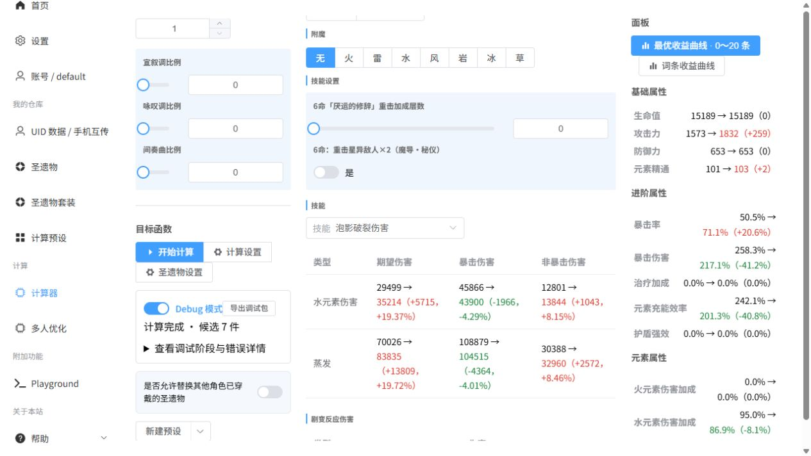

**图 3 · 自动配装的操作按钮集中在目标函数区域**

从这里打开「计算设置」和「圣遗物设置」。目标选择位于按钮下方的「普通／MONA-DSL」区域；需要排错时，先开「Debug 模式」，再开始计算。

1. 完成上面的角色、武器、BUFF 和敌人配置。
2. 在左栏选择合适的目标函数，并调整它自己的参数。
3. 打开“计算设置”，保留 A*，按需求选择套装、主词条和属性下限。
4. 确认是否允许借用其他角色已穿戴的装备，并检查锁定和圣遗物组过滤。
5. 如套装触发条件需要明确指定，在“圣遗物设置”中使用手动模式配置。
6. 点击“开始计算”，等待结果。成功后软件会将第 1 组结果应用到当前配装。
7. 切换结果序号，查看各组装备、目标值和伤害差异。
8. 满意后“存为套装”，并保存或另存计算预设。

下方“技能”决定当前伤害表显示哪一项；左侧“目标函数”决定搜索偏好。二者需要分别选择。只更换下方展示的技能，并不会让优化器改成最大化该技能。

## 4 设置角色武器与敌人

### 4.1 角色与天赋

依次设置角色、等级、三个天赋等级和命座。三个天赋输入框从左到右分别是普通攻击、元素战技、元素爆发，界面可填 1～15；命座为 0～6。

同一突破等级附近的 `80-` 与 `80+` 分别表示突破前、突破后，`90-` 与 `90+` 也需要区分。等级相同但突破状态不同，基础属性和可用天赋可能不同。

角色下方出现的额外配置用于描述当前状态，例如层数、生命比例、前后台、辉映或技能模式。按本次要计算的状态填写。切换角色后，应重新核对武器、状态和目标函数；不要沿用上一名角色的战斗条件。

### 4.2 武器

武器列表按当前角色的武器类型提供选项。选择武器后，继续设置等级、突破状态和精炼；有额外参数的武器还需要设置层数、触发条件或强化状态。

武器自身的效果参数在武器区域调整。队友武器给当前角色提供的支援效果，则通过相应 BUFF 或已支持的队友来源设置。

### 4.3 敌人设置

**入口：计算器中栏下滚→「伤害计算」→「敌人设置」。**

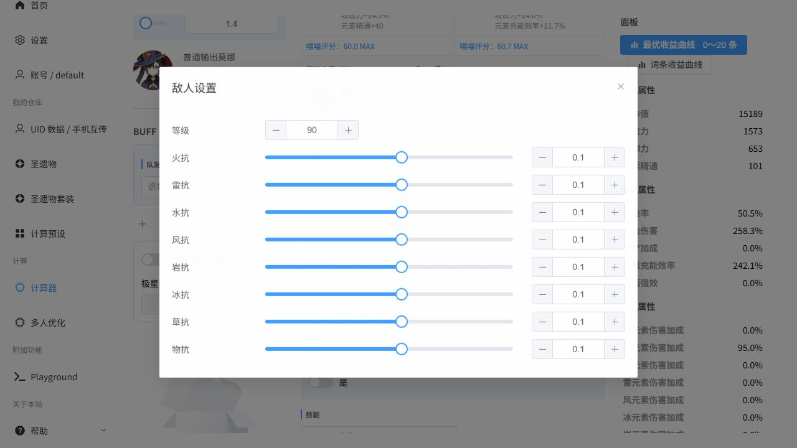

**图 4 · 在同一弹窗设置敌人等级和抗性**

等级在顶部调整，各抗性在下方填写。图中 `0.1` 代表 10%；配置后关闭弹窗，再阅读伤害或重新搜索配装。

“敌人设置”在中栏“伤害计算”上方。默认敌人等级为 90，七元素抗性及物理抗性均为 `0.1`，即 10%。可调整等级范围为 60～120，抗性范围为 -1～1。

这里的抗性使用小数比例：`0.1` 是 10%，`0` 是 0%，`-0.2` 是 -20%。设置敌人本身的抗性后，再通过 BUFF 表达减抗；不要把同一份减抗同时扣进敌人抗性和 BUFF。

当前敌人配置同时用于伤害查看、配装搜索和相关词条收益计算。比较两套配装时，应保持同一敌人条件。

### 4.4 常见输入单位

| 输入位置 | 例子 | 含义 |
| --- | --- | --- |
| 计算设置中的充能下限 | `1.8` | 180% 元素充能效率 |
| 计算设置中的暴击率下限 | `0.7` | 70% 暴击率 |
| 计算设置中的暴击伤害下限 | `1.4` | 140% 暴击伤害 |
| 计算设置中的精通下限 | `200` | 200 点元素精通 |
| 敌人抗性 | `0.1` | 10% 抗性 |
| 0～1 的覆盖率或应用比例 | `0.5` | 50% 覆盖率或应用比例 |

这张表对应上述明确位置。其他 BUFF 参数可能直接使用百分数、固定值或层数，应看该字段的名称、取值范围和默认值，不能把所有输入框都按同一种单位填写。

## 5 设置 BUFF 与队友来源

### 5.1 手动添加 BUFF

**入口：计算器左栏下滚→「BUFF」→右侧「＋」。**

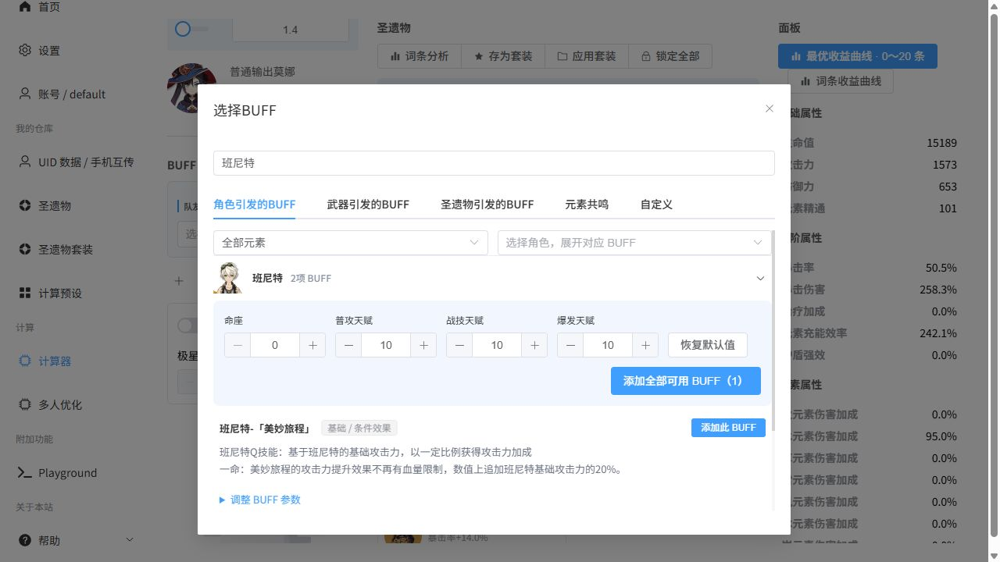

**图 5 · 搜索来源角色，设置参数，再添加所需效果**

图中以班尼特为例：顶部搜索来源；在「角色引发的 BUFF」分类核对命座和天赋；展开具体效果并填写参数，然后点「添加此 BUFF」。需要共鸣时，切换顶部「元素共鸣」分类。关闭弹窗后，在左栏检查已添加项。

点击 BUFF 区域的“＋”，在“选择BUFF”弹窗中搜索或切换分类：角色引发的 BUFF、武器引发的 BUFF、圣遗物引发的 BUFF、元素共鸣、自定义。

角色 BUFF 页签可以按元素和角色筛选。存在已导入角色时，先确认来源 UID；展开角色后，可以核对或调整该来源角色的命座和三个天赋等级，再设置具体 BUFF 的参数。

点击“添加此 BUFF”可逐项添加，也可以“添加全部可用 BUFF”。弹窗会保留，便于连续添加。**“可用”表示符合相应命座或天赋条件，并不代表本次战斗中所有效果都已触发。** 返回计算器后仍需检查触发开关、层数、前后台和覆盖率。

已添加的 BUFF 可以调整参数、删除或停用。BUFF 标题旁的锁按钮用于停用／重新启用该项；停用后保留配置，但不参与计算。

### 5.2 区分效果来源与受益角色

以“根据队友生命值／攻击力提供增益”的效果为例，来源面板应填队友自己的数值，当前角色则是接受增益的一方。不要把增益后的受益角色面板再当成来源面板，也不要重复添加角色或武器区域已经包含的同一份效果。

使用手动 BUFF 时，来源属性值属于你填写的条件。需要按已保存队友装备计算来源属性时，使用下面的“队友来源”。

### 5.3 从已保存预设关联队友

“队友来源（可选）”用于在单人计算中读取已保存队友的配置和装备，推导其支援效果。当前选择器提供沃雅妮莎、薇斯纳、奥黛塔、七七、桑多涅，最多关联三名队友。

1. 先打开队友的计算预设，配置其角色、武器和装备，再保存预设。
2. 回到受益角色的计算器，在“队友来源”中选择该预设。
3. 查看“当前装备 X/5 件”，核对来源 ID，以及“受益角色在前台”等条件。
4. 根据来源角色设置实际触发项、层数与覆盖率；如使用星扩散，核对“受益伤害模式”。
5. 出现预设丢失、装备不存在、来源 ID 重复或装备占用冲突时，按具体错误调整。

关联队友的装备会被保留，不进入当前角色的自动搜索候选。当前角色和已关联队友也不能同时占用同一件圣遗物。

手动 BUFF 可以选择“手动 BUFF 来源”，用来关联对应队友。相同效果的手动配置可能覆盖自动推导项，因此更改来源装备后，也要检查保留的手动参数是否仍符合本次条件。

这项功能服务于当前角色的单人计算，不会同时搜索整队装备，也不会把整队伤害自动合成当前目标值。

### 5.4 元素共鸣与极星辉域

普通元素共鸣从 BUFF 弹窗添加。双冰这类条件暴击效果作用于符合条件的命中，右侧基础暴击面板不一定同步增加；判断是否生效应结合该技能的期望伤害和明细。

极星辉域有独立的“启用极星辉域”开关及 0～12 层输入。按本次条件设置；角色自身的辉映、技能模式等条件仍在各自配置处填写。

## 6 当前圣遗物与装备对比

### 6.1 选择和替换装备

**入口：计算器中栏→点击要换的装备卡片→详情底部「更换此部位圣遗物」。**

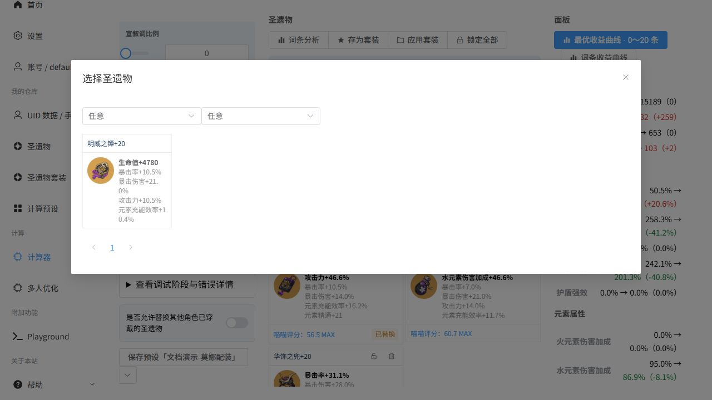

**图 6 · 从仓库中为当前部位选择装备**

进入选择窗口后，可以先用上方两个下拉框筛主词条和套装，再点击装备卡片放入当前部位。图中选择的是花，因此候选仅显示该部位。

空部位点击“＋”，从仓库选择对应部位。已有装备点击卡片，打开“圣遗物详情 · 喵喵评分”，再点击“更换此部位圣遗物”。

计算器卡片上的移除按钮只卸下当前部位，不会从仓库删除装备。仓库页的删除操作则会删除仓库记录，使用时要区分所在页面。

### 6.2 锁定的实际含义

**圣遗物的蓝底白锁表示排除后续自动配装候选，不是固定该部位。**

- 锁定装备仍可留在当前配装中，参与面板、评分、伤害和词条收益计算。
- 下一次搜索会排除锁定装备，包括当前穿戴但被锁定的装备。
- 计算器的“锁定全部”作用于当前放置的装备；全部已锁时，按钮变成“解锁全部”。

因此，若希望自动搜索继续考虑当前穿戴的好装备，不要给它们加软件锁。若希望保护另一名角色的装备，使用已穿戴保护或“过滤圣遗物组”更便于按角色管理。

### 6.3 评分与词条分析

卡片下方显示当前角色的喵喵评分，上方显示整套圣遗物总分和评级。详情弹窗可查看普通评分、角色评分、主副词条得分贡献，以及其他角色的评分排名。

评分用于快速判断词条与角色的匹配程度。自动配装按照当前目标函数排序，最终伤害还受套装效果、BUFF、属性搭配和充能需求影响，所以高评分不必然对应本次目标的最高值。

“词条分析”统计当前装备的属性数值、折合词条和强化次数范围，适合观察装备中各类属性的投入情况。它与右栏的伤害收益曲线用途不同。

### 6.4 选择对比基准

开启“圣遗物对比”后，可以选择：

| 基准 | 用途 |
| --- | --- |
| 游戏内穿戴 | 与该 UID 最近保存或同步的游戏装备对比；需要存在对应角色数据 |
| 此次计算前 | 与本次搜索开始前放在计算器中的装备对比，搜索成功后建立基准 |
| 对比历史 | 从已记录的历史配装中选择一组作为基准 |

点击“保存当前配装到历史”可记录当前装备。计算结果切换时也会记录对应配装。卡片显示“已替换”“新增”“已卸下”等变化，面板和伤害表显示前后数值及差值；伤害表还显示相对提升。

这里比较的是装备：历史保存装备快照，伤害按当前角色、BUFF 和敌人等条件重新计算。若你之后更改了 BUFF，历史基准的伤害也会按新条件求值，并非复现当时的全部战斗环境。“游戏内穿戴”也以最近同步记录为准，不会实时读取游戏换装。

## 7 自动配装的目标与搜索设置

### 7.1 先确定要优化什么

左栏“目标函数”是搜索的核心。普通页签分为角色专属目标与通用目标：

| 目标类型 | 适合的需求 | 需要核对 |
| --- | --- | --- |
| 角色专属 | 使用该角色既有的技能或输出模型 | 目标说明、充能需求及其他专属参数 |
| 通用属性目标 | 追求最大攻击力、防御力等属性 | 该属性是否真能代表你的使用目的 |
| 通用元素伤害目标 | 按指定元素、技能类别和基础属性寻找配装 | 期望／最大值、技能类别、攻击／防御／生命等选项 |
| MONA-DSL | 自定义技能次数、反应比例或技能组合 | 具体技能标识、状态参数和最终 `result` |

通用“风伤”等目标并不等于某个具体技能的完整公式。目标值也不一定是单次伤害或每秒伤害：它可能是面板属性或多个技能的加权和。

角色目标中的“充能需求”与“计算设置”的充能下限是不同入口，具体评分方式取决于所选目标。需要明确保证配装达到某个充能条件时，同时检查搜索设置中的下限，不要仅凭目标名称判断循环是否足够。

**薇斯纳当前限制：** 普通页签的角色专属快捷目标为“薇斯纳-灵剑·爆发”。界面虽列出通用目标，部分目标仍会被当前适配层拒绝。需要优化其他已支持灵剑技能时，可使用 DSL；不要把普通风伤目标当作星扩散公式。

### 7.2 计算设置

**入口：计算器左栏「目标函数」→「计算设置」。**

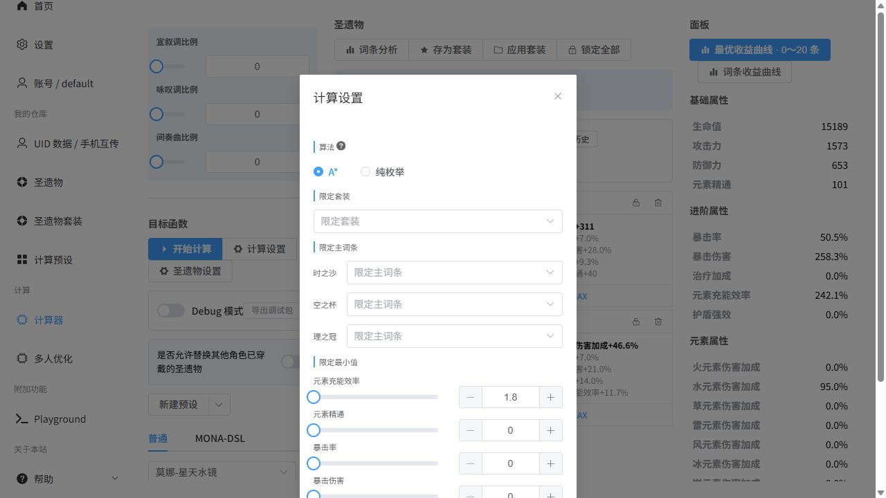

**图 7 · 设置这次允许搜索的装备范围**

按从上到下的顺序选择算法、套装、三部位主词条和属性下限。图中充能下限为 `1.8`，即 180%；套装和主词条留空表示不限制。设置后关闭弹窗，回到「开始计算」执行搜索。

#### 算法

默认 A*，通常先使用该项。纯枚举在候选多、套装或主词条不受限时计算量很大；选择它之前先明确缩小搜索范围。当前没有提供可选的“启发式剪枝”按钮，旧说明中出现这一名称不代表现在可以切换。

#### 限定套装

| 选择 | 搜索要求 |
| --- | --- |
| 留空 | 不限制套装组合 |
| 选择一个套装 | 要求该套装的四件套，剩余部位可散搭 |
| 选择两个套装 | 要求两个套装分别组成二件套，即 2＋2 |

选两个套装不是在两个四件套之间择优。想比较 A 四件套与 B 四件套，应分别运行两次，并保持其他条件一致。

#### 限定主词条

时之沙、空之杯、理之冠分别设置，均可多选。某部位留空表示不按主词条筛选；多选表示保留所选主词条的候选。例如沙漏同时选攻击力百分比和充能，表示允许两种沙漏竞争。

这里只过滤候选，不会修改装备主词条，也不会改变当前手动放入的装备。

#### 限定最小值

当前可设置充能、精通、暴击率和暴击伤害下限。充能范围为 1～4，精通为 0～2000，暴击率为 0～1，暴击伤害为 0～4。百分比使用小数比例，参见第 4.4 节。

这些条件需要同时满足。套装、主词条和属性下限叠加后若没有可行组合，搜索不会给出结果。条件暴击等特定命中属性与右侧基础面板存在口径区别，不能把每项下限都当成某次技能最终生效属性的完整展示。

#### 过滤圣遗物组

**入口：同一个「计算设置」弹窗继续向下滚动→「过滤圣遗物组」。**

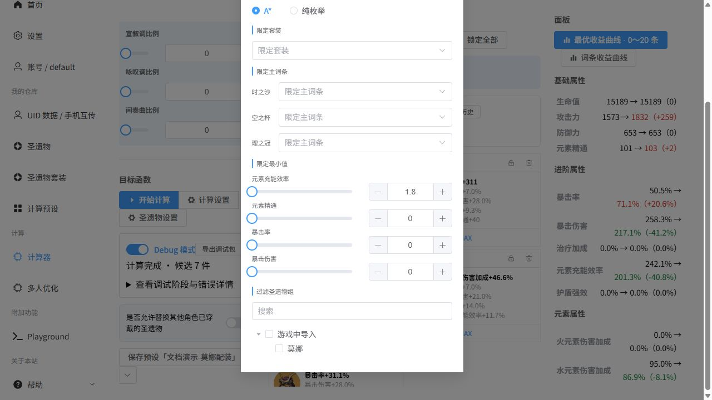

**图 8 · 展开收藏夹后勾选需要保护的圣遗物组**

输入组名搜索，或点击收藏夹左侧小三角展开，再勾选组名旁的方框。图中仅展开「游戏中导入」，尚未勾选；勾选后的含义是保护该组装备、将其排除出搜索。

在树形列表中勾选需要保护的圣遗物组，可按组名或角色搜索。勾选表示排除该组里的装备，不是仅在该组中搜索。

当前角色已放在计算器中的装备不会仅因出现在被过滤组中而被排除；但它们仍受软件锁定、强化等级、主词条及其他占用规则影响。

### 7.3 是否借用其他角色装备

“是否允许替换其他角色已穿戴的圣遗物”决定是否将当前 UID 下其他已导入角色的穿戴装备纳入候选：关闭时保留这些装备，开启时允许借用。

该判断依赖软件已保存的 UID 穿戴记录。仅有 GOOD 导入生成的圣遗物组、没有对应 UID 角色记录时，可通过“过滤圣遗物组”保护装备。

关联为“队友来源”的装备会单独保留，开启借用开关也不会释放它们。

### 7.4 圣遗物特效模式

**入口：计算器左栏「目标函数」→「圣遗物设置」→「手动」。**

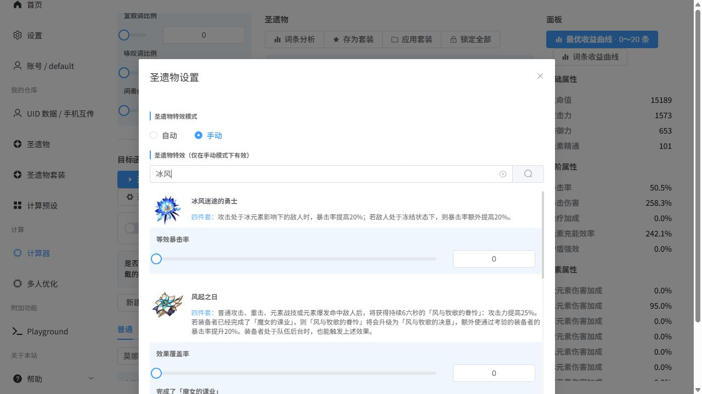

**图 9 · 搜索套装并填写对应触发条件**

图中搜索「冰风」后，可调整相关效果参数；实际搜索可能同时显示其他匹配项，应核对套装名称。设置完成后关闭弹窗，再开始配装计算；需要恢复内核默认处理时切回「自动」。

“圣遗物设置”控制搜索时使用的套装效果配置：

- **自动：** 不提交手动特效配置，使用计算内核对候选套装的自动／默认处理。
- **手动：** 使用弹窗中设置的套装参数，可搜索套装后填写触发、层数或覆盖率等条件。

自动模式不会读取真实战斗过程，也不表示一律满层。需要比较某个明确状态时，手动指定相关套装条件更容易保持一致。

中栏当前装备下方的二件套／四件套参数用于当前配装的伤害和面板，是另一处配置。**比较搜索目标值与页面伤害前，应让两处套装条件一致。** 例如搜索按未触发计算、当前配装按满层展示时，数字不能直接对应。

### 7.5 候选范围核对表

某件装备没有进入结果时，可以依次检查：

1. 是否在当前莫娜账号的仓库中，且强化达到 +16。
2. 是否被软件锁定。
3. 是否被沙漏、杯子或头冠主词条筛选排除。
4. 是否被其他角色穿戴保护、关联队友占用或圣遗物组过滤排除。
5. 能否与其他部位共同满足限定套装和全部属性下限。

搜索结果只在这次条件和候选范围内比较。更改任何一项条件后，应重新“开始计算”，才能得到新条件下的结果排名。

## 8 阅读伤害与搜索结果

### 8.1 三种伤害数值

**入口：计算器中栏下滚→「伤害计算」→「技能」下拉框。**

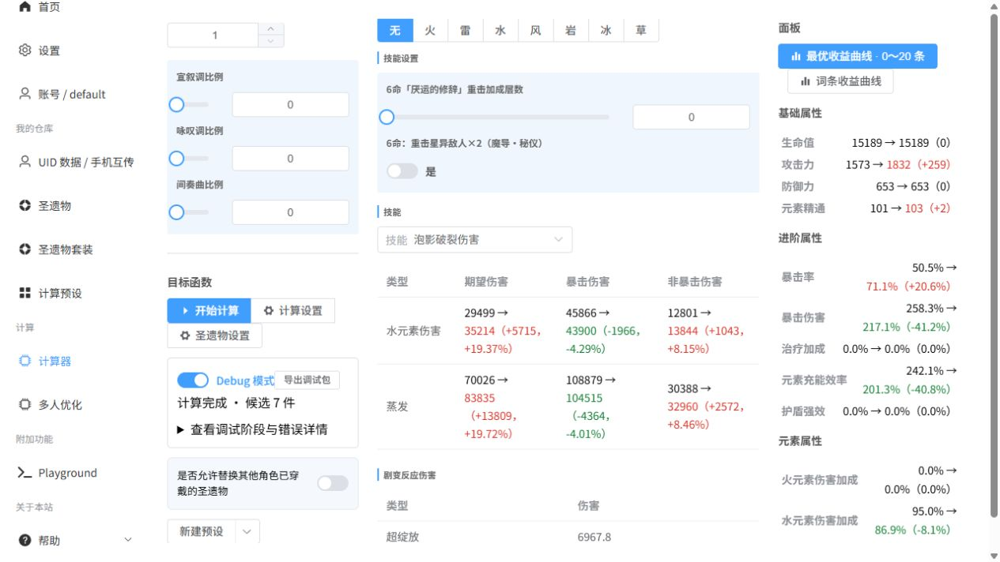

**图 10 · 选择具体技能后，横向阅读三列伤害**

图中查看莫娜「泡影破裂伤害」，对比基准为「此次计算前」。水伤期望由 `29,499` 变为 `35,214`，提升 `19.37%`；暴击伤害却下降，说明应按自己的目标选择要比较的列。右栏同时显示面板变化。

| 列 | 含义 |
| --- | --- |
| 期望伤害 | 考虑本次命中有效暴击率后的平均伤害，适合比较长期平均输出 |
| 暴击伤害 | 此次命中发生暴击时的伤害，不代表必定暴击 |
| 非暴击伤害 | 此次命中未暴击时的伤害 |

对可暴击伤害，可以用“非暴击伤害 ×（1－有效暴击率）＋暴击伤害 × 有效暴击率”理解期望值。有效暴击率可能含仅对特定命中生效的加成，与右栏基础暴击率不完全相同。治疗等不能按普通攻击判暴的结果，应按该技能自己的规则阅读。

伤害表按当前技能展示相关伤害类型，例如普通元素／物理伤害、蒸发、融化、超激化或蔓激化。不同反应行通常是不同条件下的结果，**不能把它们相加当成该次命中的总伤害**。表中出现蒸发预览，也不表示游戏中每次命中都会触发蒸发。

保留的直接月感电、直接月绽放、直接月结晶、直接星超导和直接星扩散，按相关角色技能显示。它们与独立星／月反应入口不同；当前常规版本不提供已移除的独立反应、多人贡献或主 C 手填面板功能。

### 8.2 技能设置与附魔

在“伤害计算”中选择具体技能后，核对该角色的“技能设置”，例如是否冲刺后、技能阶段或其他命中条件。附魔用于相关技能的元素计算；应根据技能实际机制选择，不能把它当成所有技能的任意元素转换开关。

下方附魔不会自动改写左栏目标函数。用 DSL 优化时，也要在相应技能声明中表达需要的技能状态。

### 8.3 伤害明细

**入口：中栏「伤害计算」标题旁「明细」。**

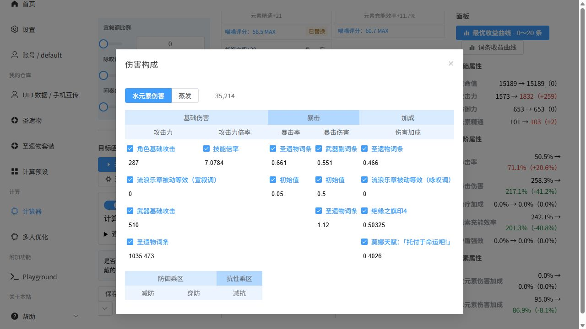

**图 11 · 展开当前技能的伤害组成**

先在顶部切换水伤、蒸发等可用类型，再阅读下方来源。图中展示攻击力、技能倍率、双暴和绝缘四件套等项目；排查差异时，从不一致的来源返回原配置区域核对。

点击“明细”打开“伤害构成”，可切换当前技能可用的伤害类型，查看其提供的基础伤害、属性与倍率、增伤、防御和抗性等组成。直接星烁伤害的详情以实际期望、暴击和非暴击数值呈现，详情展开形式与普通伤害不同。

明细中的勾选和数值可用于局部观察。它们属于该明细弹窗，不会替你修改左侧角色、BUFF、敌人或搜索目标；需要正式比较时，应回到相应配置区域修改。

“剧变反应伤害”是另一张表，包含当前返回的绽放、超绽放、烈绽放、感电、超载、扩散等结果；其中结晶项表示结晶盾量。这里的各行也不自动组成一轮输出，不能与技能表逐行累加。

### 8.4 自动搜索结果

**入口：点击「开始计算」完成后→左栏目标函数下方。**

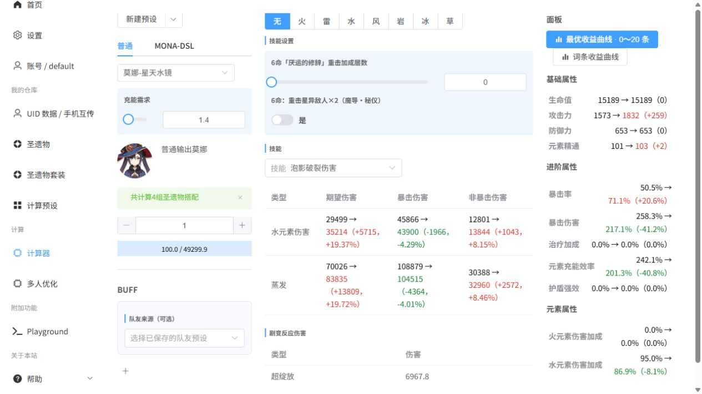

**图 12 · 用结果序号切换配装，再到中栏和右栏查看变化**

本例 7 件合成候选返回 4 组，当前是第 `1` 组，显示 `100.0 / 49299.9`。用序号输入框或「－／＋」切换；第一项是本次结果中的相对值，第二项是目标函数值。需要看换装提升时，打开中栏「圣遗物对比」并选择基准。

成功后，结果序号可在本次返回的配装中切换，当前五件装备会随之替换。

- “共计算 X 组圣遗物搭配”中的 X 是返回的结果组数，不是内核遍历过的所有组合数。
- 序号下方的相对值按本次最佳目标值归一化，最佳通常显示 `100.0`；后面的数值是当前组的目标函数值。
- 这个相对值不是相对于游戏内装备的提升百分比。要看实际换装提升，使用“圣遗物对比”。

目标函数如果累计了多个技能，页面下方单个技能的伤害不需要等于该目标值。目标值、喵喵评分和单次伤害也不属于同一种分数。

## 9 面板与词条收益曲线

### 9.1 面板

右栏显示生命、攻击、防御、精通、双暴、治疗、充能、护盾强效及各类伤害加成。桌面将指针移到属性名称上，可以查看数值来源。

面板用于检查基础配置和属性变化。某些只在攻击特定目标、特定元素或技能时生效的属性会在伤害环节使用，因此“基础面板不变”不等于“该效果没计入伤害”。双冰条件暴击就是当前已确认的例子。

### 9.2 词条收益曲线

**入口：计算器右栏顶部→「词条收益曲线」。**

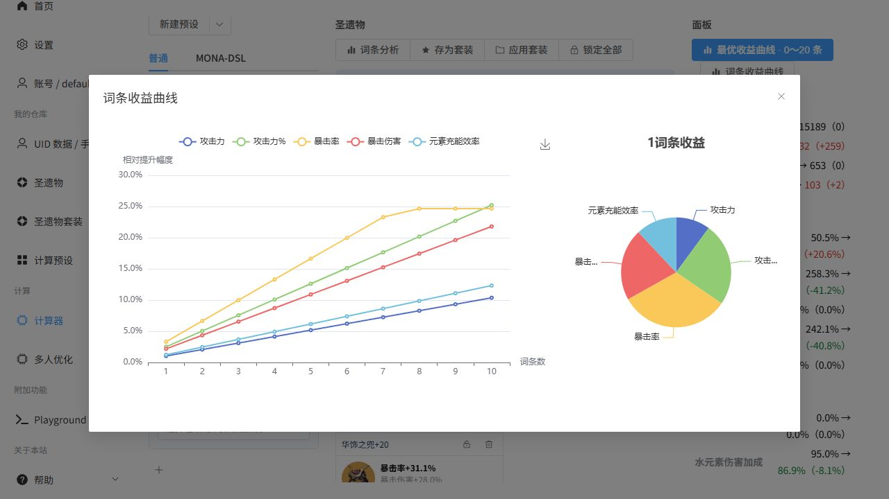

**图 13 · 分别追加一种属性时的收益比较**

左侧按追加词条数比较各属性，右侧查看增加一条的收益占比。先确认左栏目标函数，再比较曲线；此图对应普通目标「莫娜-星天水镜」。

“词条收益曲线”依据左侧当前目标函数，比较分别追加攻击、双暴、精通、充能等属性词条带来的相对提升。折线图横轴是追加词条数，饼图展示增加 1 条时的各属性收益。

使用前先确定目标函数符合你的培养需求。各条属性曲线用于比较单独投入某种属性的收益，不会替你完成多属性之间的最优分配，也不会替换仓库装备。

### 9.3 最优收益曲线

**入口：计算器右栏顶部→「最优收益曲线 · 0～20 条」。**

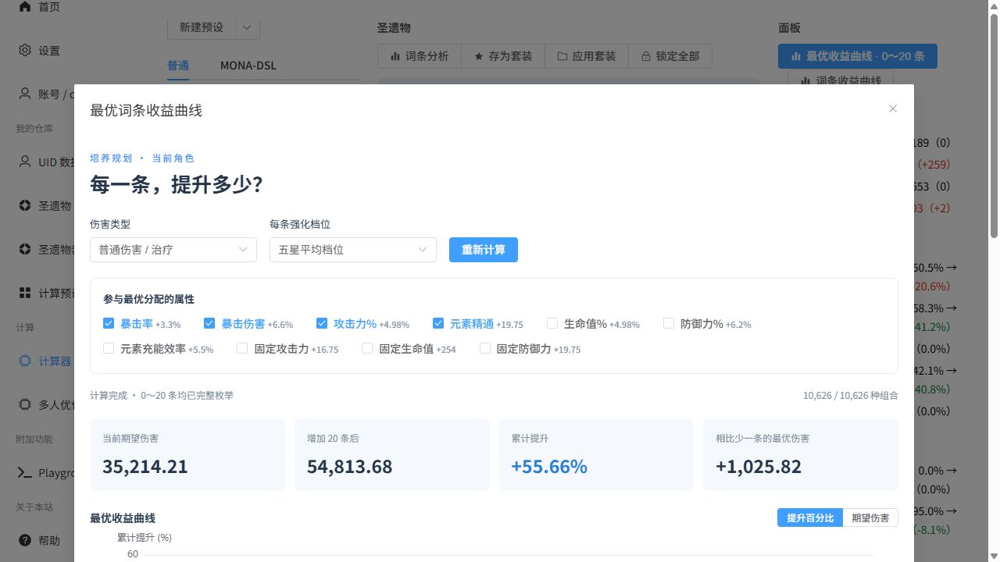

**图 14 · 先确定伤害类型、强化档位与参与分配的属性**

本例按当前「泡影破裂伤害」的普通水伤期望计算，选择五星平均档位以及双暴、攻击力百分比和精通。状态显示「0～20 条均已完整枚举」后，再查看全部预算结果。

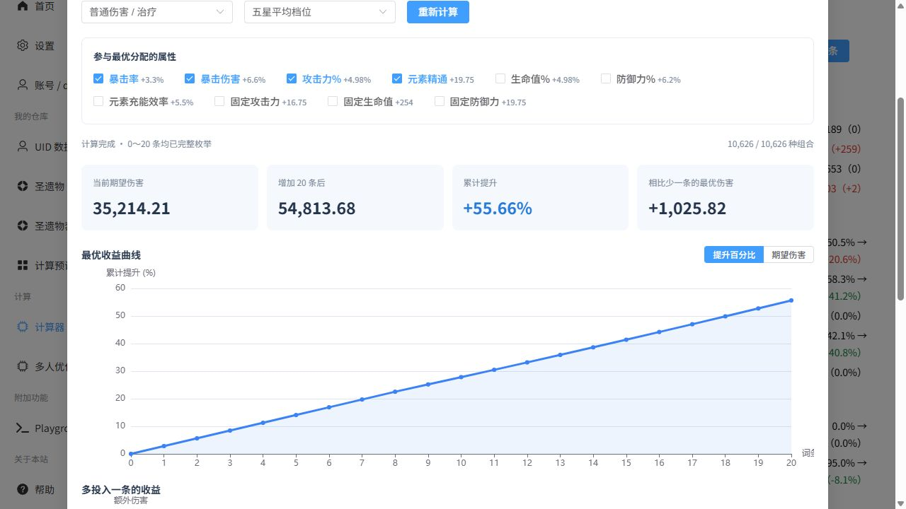

**图 15 · 向下滚动查看曲线，选择预算或切换纵轴**

点击曲线上的某个预算点，或继续下滚拖动滑块。纵轴可切换「提升百分比／期望伤害」；下方柱形图用于看每多一条的伤害收益。

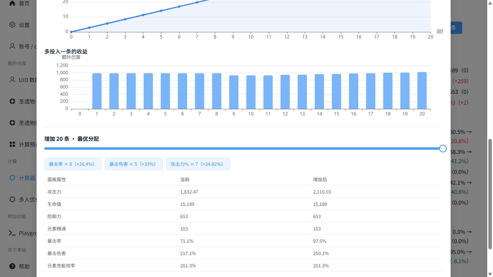

**图 16 · 继续下滚查看最优分配与面板，底部可导出 JSON**

图中 20 条预算分配为暴击率 8 条、暴击伤害 5 条、攻击力百分比 7 条。拖动预算滑块会更新分配和面板；「导出完整结果 JSON」在弹窗更下方。这是理论追加词条的规划结果，不代表仓库里已经存在对应圣遗物。

点击“最优收益曲线 · 0～20 条”，按以下顺序查看：

1. 选择伤害类型。选项来自当前下方技能可用的结果，计算比较的是该项期望伤害。
2. 选择每条强化档位：五星平均档位或五星最高档位。
3. 勾选参与分配的属性，例如双暴、攻击力百分比和精通；生命或防御模型可调整为相应属性。
4. 等待计算完成，或在更改选项后点击“重新计算”。
5. 点击曲线点或拖动词条预算滑块，查看增加对应条数后的最高期望伤害、累计提升、比少一条多出的伤害，以及最优分配和面板变化。
6. 完整计算结束后，可以导出结果 JSON。

这里的“0 条”是当前配装，每个预算分别枚举所选属性的分配，寻找该预算下的最高期望值。它表示在当前配装上**理论追加**词条，不受单件圣遗物四条副词条、主副词条互斥或实际强化次数约束，也不会从仓库寻找可直接替换的装备。

可选属性越多，组合数越大；超过 100 万组合时需要减少参与分配的属性。支持停止计算，但停止后的部分结果不能当成 0～20 条全部完成的结果。

两种曲线关注的目标不同：旧“词条收益曲线”跟随左栏目标函数；“最优收益曲线”跟随当前具体技能及弹窗中选定的伤害类型。解读前先确认自己正在比较哪一个目标。

## 10 保存预设套装与跨设备数据

### 10.1 保存计算预设

**入口：计算器左栏「目标函数」附近→「新建预设」；已有预设时用旁边下拉箭头选择「另存为预设」。**

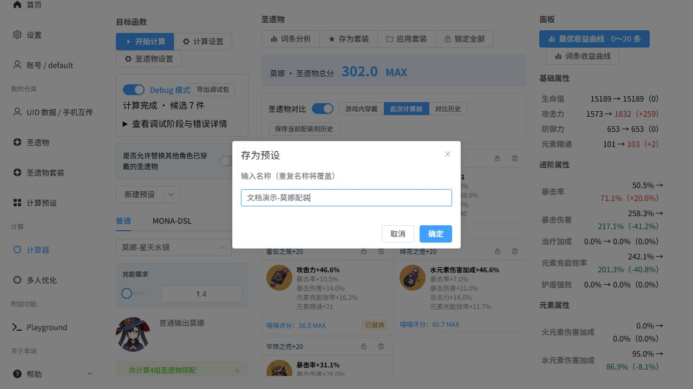

**图 17 · 为计算配置命名后点确定**

输入容易辨认的名称，点击「确定」。保存成功后，主按钮会显示「保存预设『名称』」；以后点击主按钮会更新该名称。重复名称会覆盖，保留两套方案时使用不同名字。

没有当前预设时，点击“新建预设”并命名；已加载预设时，主按钮保存到当前名称，下拉菜单可以“另存为预设”或加载其他预设。列表支持元素筛选，以及最近更新／元素属性排序。

| 当前预设会保存 | 复用时还需单独核对 |
| --- | --- |
| 角色、等级、命座、三个天赋和角色参数 | 敌人等级与抗性 |
| 武器、等级、精炼和武器参数 | 下方伤害表选中的技能及技能设置 |
| BUFF、停用状态及来源关联，队友来源配置 | 附魔 |
| 当前装备的仓库引用 | 中栏当前装备下方的套装特效参数 |
| 目标函数及参数、DSL 模式与代码 | “过滤圣遗物组”的本次勾选 |
| 算法、套装要求、主词条筛选、四项属性下限 | 借用其他角色装备开关、对比基准等独立状态 |
| 搜索用的圣遗物特效模式和手动配置 | — |

装备在预设中保存的是仓库引用，不是完整仓库副本。相关装备被删除或换到不含这些记录的数据集后，预设中的对应部位可能为空。分享预设时，不能只凭一份预设文件保证对方获得相同装备与伤害环境。

“计算预设”页面支持全部导出、单个导出和导入。导入同名预设会覆盖对应名称的配置，导入前可先导出已有预设。

### 10.2 存为套装与应用套装

**保存入口：计算器中栏顶部→「存为套装」。加载入口：相邻的「应用套装」。**

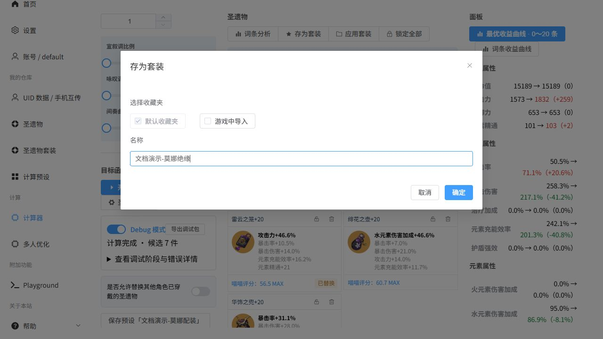

**图 18 · 只保存当前五件装备组合**

勾选要放入的收藏夹，填写套装名称，再点击「确定」。需要换回这组装备时，点击「应用套装」，展开对应收藏夹并选择组名。若要同时复用角色、武器和 BUFF，再保存一份计算预设。

“存为套装”将当前装备组合保存到选择的收藏夹；“应用套装”把已保存圣遗物组中的装备放入计算器。它不会替你加载角色、武器、BUFF 或目标函数。

可以用收藏夹区分角色、用途或备用方案，例如“深渊常用”“充能方案”“待比较”。保护这些装备时，再到计算设置中勾选相应圣遗物组。

### 10.3 导出与跨设备

| 要带走的数据 | 使用入口 |
| --- | --- |
| 仓库圣遗物及对应导出数据 | “圣遗物”页导出莫娜 JSON |
| 计算配置 | “计算预设”页导出 |
| 指定 UID 的角色、相关装备和预设等数据 | “UID 数据 / 手机互传”中“导出此 UID 到手机 / 电脑” |
| 已保存角色的原始快照 | 同一页面“导出角色快照” |

跨设备使用时，在目标设备点击“导入 UID 数据包 / 角色快照”，选择导出的 JSON。UID 数据包比仅导出预设更适合迁移角色及相关装备；角色快照与完整 UID 数据包仍应按各自用途区分。

“附带未标记 UID 的仓库圣遗物（归入此 UID）”会把这些未归属装备一并放入该 UID 数据包。多个 UID 混用仓库时，导出前确认勾选范围。

导入记录中可以查看来源、时间和新增数量，并对支持的记录“撤销导入”。若装备或预设已有后续修改／引用，撤销会按实际情况保留相关数据，以界面结果为准。

数据保存在对应应用或浏览器的本地存储中。跨设备通过导出和导入传递。设置中的清空本地存储会清除本地数据，不应把它当成计算报错的常规处理方法。导出文件和 Debug 包可能包含 UID、角色或装备配置，分享前确认内容；Cookie 属于登录凭据，不要放进公开文档或反馈截图。

## 11 使用 MONA-DSL 自定义目标

当现有目标不符合你的输出方式时，切换目标函数区域的“MONA-DSL”页签。代码必须把最终数值赋给 `result`，搜索器按这个数值比较候选配装。

### 11.1 一个技能的期望伤害

**入口：左栏「目标函数」→「MONA-DSL」页签→代码框→填写后回到上方「开始计算」。**

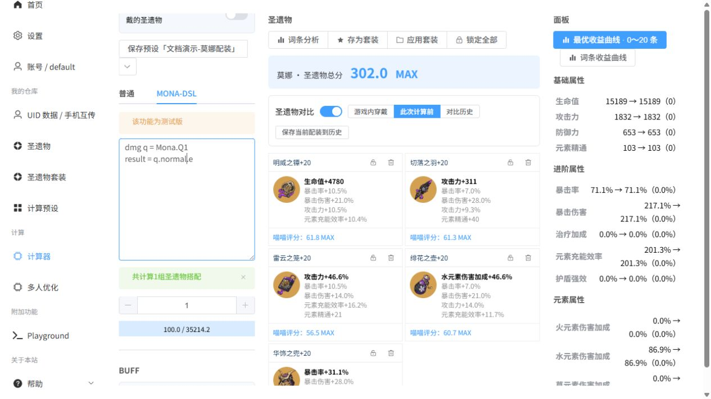

**图 19 · 输入目标表达式，再重新开始计算**

截图使用当前莫娜的泡影破裂作为搜索目标：

```text
dmg q = Mona.Q1
result = q.normal.e
```

本例搜索完成后显示 `100.0 / 35214.2`，与同条件下「泡影破裂伤害」的水伤期望对应。修改代码或战斗条件后，需重新点击「开始计算」，已有排名不会自动刷新。

以下以神里绫华为当前角色，使用冲刺后的爆发切割伤害作为目标：

```text
dmg q = KamisatoAyaka.Q1({ after_dash: true })
result = q.normal.e
```

`KamisatoAyaka` 和 `Q1` 是代码标识，不能直接换成中文名称。`after_dash: true` 表达该声明的技能状态。`normal` 指该技能未进行蒸发／融化等反应的伤害分支，不表示“普通攻击”。

### 11.2 混合两种反应条件

如果你想比较“该段伤害一半不融化、一半融化”的平均值：

```text
dmg q = KamisatoAyaka.Q1({ after_dash: true })
result = q.normal.e * 0.5 + q.melt.e * 0.5
```

这里的比例是你设定的输出模型，软件不会自动验证实际循环能否达到 50% 融化。也可以用命中次数作为权重，但加权和只有在明确除以持续时间后才具有每秒伤害的含义。

### 11.3 读取结果

| 写法 | 含义 |
| --- | --- |
| `.normal.e` | 普通伤害分支的期望值 |
| `.normal.c` | 普通伤害分支的暴击值 |
| `.normal.n` | 普通伤害分支的非暴击值 |
| `.melt.e` | 融化分支的期望值，要求该技能提供此分支 |
| `.vaporize.e` | 蒸发分支的期望值，要求该技能提供此分支 |

不是每个技能都提供所有分支。读取不存在的分支会报错，应核对当前角色、技能标识与参数。直接星／月伤害的技能及结果字段需要按当前对应实现使用，不能把普通风伤或旧独立反应标识直接套入。

DSL 使用计算器配置的角色、武器、BUFF、敌人和候选装备。下方技能选择与该声明的技能仍是两个入口；要对照数值，应让技能和条件一致。已有伤害结果可重复引用，避免为同一技能条件重复声明。

语法说明见 [MONA-DSL 概览](../mona_dsl_book/src/overview.md)与[伤害声明](../mona_dsl_book/src/grammar/damage_statement.md)。旧语法资料中的历史功能不能据此认定为当前常规版仍支持的入口。

## 12 常见问题与 Debug

### 为什么没点开始计算就出现伤害

当前伤害根据已放入的装备和参数直接更新。“开始计算”用于搜索仓库配装。仅看一次技能伤害，可以按第 3.2 节操作。

### 为什么更换技能后配装排名没有变化

中栏技能切换只改变当前伤害展示。先更改左侧目标函数或 DSL，再重新开始计算。BUFF、敌人或套装条件变更后，之前返回的排名也需要重新计算。

### 为什么手动换装后某项伤害高于搜索结果

先检查搜索目标是否就是这一技能及反应，再检查主词条、下限、软件锁、其他角色保护和组过滤。随后对齐搜索与当前配装的套装特效、BUFF、附魔和技能状态。搜索目标为多个技能加权和时，某个单独技能更高也不表示该组合目标更高。

### 为什么锁住当前装备后搜索不到它

软件锁会将装备排除出搜索候选，当前穿戴也不例外；它不会把该部位固定进每一组结果。解锁后重新计算。

### 为什么没有符合条件的圣遗物

检查当前账号仓库、+16 门槛、五个部位候选、主词条、装备保护与锁定。再检查四件套／2＋2要求，以及四项属性下限能否同时满足。若只需定位是哪项条件导致无解，可逐项放宽后重新计算，但放宽后的结果仅适用于新条件。

### 为什么双冰后基础暴击率没增加

双冰提供条件命中暴击，当前实现已将其计入符合条件的实际伤害，右侧基础面板不含这项条件暴击。检查应用比例和期望伤害，不要额外再添加一份 15% 通用暴击，否则可能重复计算。

### 为什么薇斯纳选择其他快捷目标报错

当前普通快捷目标限制仍存在。先使用“薇斯纳-灵剑·爆发”；其他已支持技能可按其真实标识使用 DSL。下方能显示某技能伤害，不代表已有同名快捷优化目标。

### 为什么一直显示莫娜占卜中

搜索规模受候选属性分布、套装组合和目标复杂度共同影响。先确认使用 A*，再按实际需求限定套装和主词条。缩小范围可用于临时完成特定条件下的搜索，但会改变允许的解空间。

当前单次搜索超时为 10 分钟。哥伦比娅的部分输入存在尚未修复的原生搜索性能问题，不能只凭候选件数判断是否会超时，也不能把缩小范围后完成当成该问题已修复。

### 如何导出可定位问题的 Debug

**入口：左栏「开始计算」下方→「Debug 模式」→复现→「导出调试包」。** 位置见[快速上手的操作按钮截图](#33-从仓库搜索一套配装)。展开同一区域的「查看调试阶段与错误详情」可阅读阶段记录。

1. 在点击“开始计算”之前打开“Debug 模式”。
2. 按原条件复现一次，保留页面上的具体错误。
3. 展开“查看调试阶段与错误详情”，查看加载、开始、完成或错误阶段。
4. 点击“导出调试包”，保存 `mona-debug-…json`。
5. 反馈时说明软件版本、角色、目标、复现操作，以及实际和预期结果；需要数值对比时注明技能、反应和 BUFF 条件。

Debug 包记录本次输入、过滤后的候选装备、候选数量、执行阶段、错误及结果摘要，默认保留在页面内存中，需主动导出。它不是完整账号备份；可能包含个人装备配置，适合按需私下提供排查。

## 附录 源码索引

下列文件可用于维护本文与界面行为的一致性。此处源码链接按本文位于项目 `docs/` 目录编写，单独分享图文时需回到 7.1.11 源码查看：

| 内容 | 主要源码 |
| --- | --- |
| 计算器界面、搜索过滤、预设保存和对比调用 | [NewArtifactPlanPage.vue](../src/pages/NewArtifactPlanPage/NewArtifactPlanPage.vue) |
| 套装模式、主词条与属性下限 | [constraint.ts](../src/composables/constraint.ts) |
| 敌人默认值及输入范围 | [enemy.ts](../src/composables/enemy.ts)、[EnemyConfig.vue](../src/pages/NewArtifactPlanPage/EnemyConfig.vue) |
| 当前装备与套装特效配置 | [artifact.ts](../src/composables/artifact.ts) |
| BUFF 弹窗与角色参数 | [SelectBuff.vue](../src/components/select/SelectBuff.vue)、[CharacterBuffGroups.vue](../src/components/select/CharacterBuffGroups.vue) |
| 队友来源与装备保护 | [single-team-context.mjs](../src/algorithms/single-team-context.mjs)、[artifact-ownership.mjs](../src/algorithms/artifact-ownership.mjs) |
| 伤害类型和表格展示 | [reaction-labels.mjs](../src/algorithms/reaction-labels.mjs)、[DamagePanel.vue](../src/pages/NewArtifactPlanPage/DamagePanel.vue) |
| 装备对比和历史 | [artifactComparison.mjs](../src/composables/artifactComparison.mjs) |
| 两种收益曲线 | [ArtifactPerStatBonus.vue](../src/components/display/ArtifactPerStatBonus.vue)、[OptimalStatGainCurve.vue](../src/components/display/OptimalStatGainCurve.vue)、[curve.mjs](../src/algorithms/stat-gain/curve.mjs) |
| 米游社及 UID 数据导入导出 | [MiyousheImport.vue](../src/components/import/MiyousheImport.vue)、[uid-package.mjs](../src/import/uid-package.mjs) |
| 圣遗物 JSON 与 GOOD 导入 | [artifacts.ts](../src/utils/artifacts.ts)、[good.ts](../src/import/good.ts) |
| 搜索超时与 Debug 数据 | [single-optimize-task.mjs](../src/wasm/single-optimize-task.mjs)、[optimization-debug.mjs](../src/wasm/optimization-debug.mjs) |
| 当前已知限制与版本状态 | [AGENTS.md](../AGENTS.md) |
